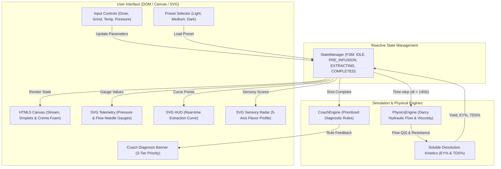
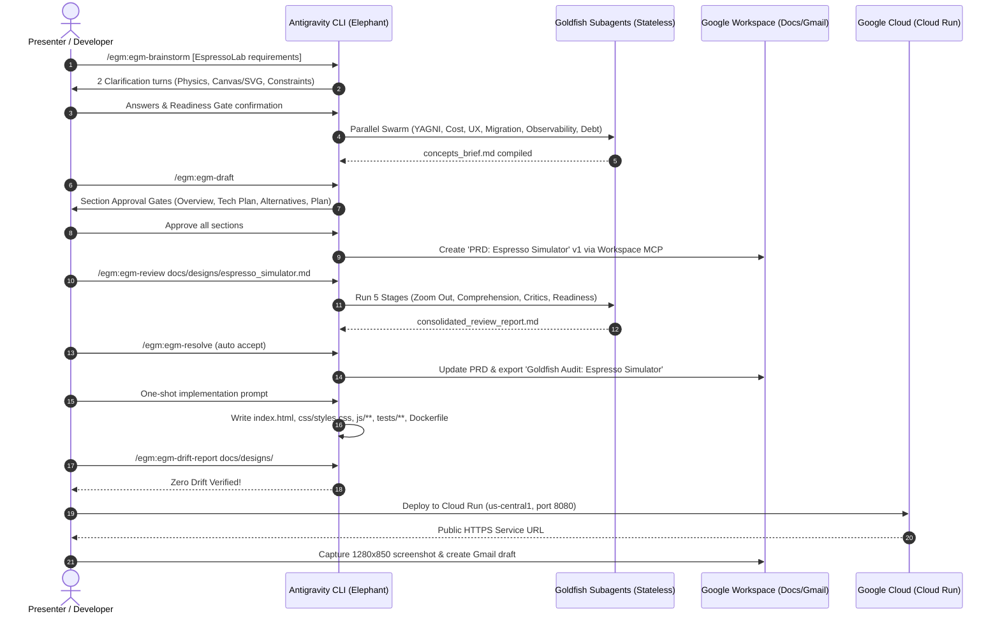

# EspressoLab — Espresso Dial-In Simulator

> **DevFest 2026 Live Demo Reference Implementation**: Built and verified end-to-end using **Google Antigravity (AGY)**, the **Elephant-Goldfish Model (EGM)** plugin, and **Google Cloud & Google Workspace Model Context Protocol (MCP)** integrations.

EspressoLab is a zero-backend, client-side educational microapplication designed to teach home baristas the fluid dynamics, mass conservation, and sensory principles of dialing in espresso. Running entirely in the browser using vanilla ES6+ JavaScript, HTML5 Canvas, SVG, and CSS3, the simulator delivers real-time physical feedback across a fixed 1280x850 desktop viewport without scrolling.

---

## Table of Contents

- [Key Features](#key-features)
- [System & Multi-Agent Architecture](#system--multi-agent-architecture)
  - [1. Simulator Runtime Architecture](#1-simulator-runtime-architecture)
  - [2. Elephant-Goldfish Model (EGM) Workflow](#2-elephant-goldfish-model-egm-workflow)
  - [3. End-to-End Sequence Diagram](#3-end-to-end-sequence-diagram)
- [How to Reproduce This Demo (Step-by-Step Runbook)](#how-to-reproduce-this-demo-step-by-step-runbook)
  - [Part 0: Pre-Demo Prerequisites & Setup](#part-0-pre-demo-prerequisites--setup)
  - [Part 1: Launch AGY & Inspect Integrations](#part-1-launch-agy--inspect-integrations)
  - [Part 2: Create, Verify & Sync the PRD with EGM + Google Docs MCP](#part-2-create-verify--sync-the-prd-with-egm--google-docs-mcp)
  - [Part 3: Build, Verify Drift, Deploy to Cloud Run & Draft Gmail](#part-3-build-verify-drift-deploy-to-cloud-run--draft-gmail)
  - [Part 4: Time-Boxed Stage Variations](#part-4-time-boxed-stage-variations)
- [Local Development & Running](#local-development--running)
- [Keyboard Shortcuts](#keyboard-shortcuts)
- [Automated Test Suite](#automated-test-suite)
- [Repository Artifacts Directory](#repository-artifacts-directory)

---

## Key Features

- **Darcy Hydraulic Flow Model**: Algebraic discrete frame-integrated porous bed resistance simulation modeling pre-infusion delay ($t_{\text{dwell}}$), dynamic temperature-dependent viscosity $\mu(T)$, initial resistance $R_0$, and late-stage bed erosion floor clamping ($R_{\text{bed}} \ge 0.25 R_0$).
- **Soluble Mass Dissolution Kinetics**: Real-time extraction yield ($EY\%$), total dissolved solids ($TDS\%$), and dynamic stream color interpolation (umber $\rightarrow$ tiger striping $\rightarrow$ blonding) driven by an exponential washout proxy.
- **Mass Conservation Guarantee**: Decoupled 60Hz numerical physics stepping ($\Delta t = 1/60\text{s}$) with spiral-of-death protection ensuring cumulative cup yield strictly equals $\sum Q(t) \cdot \Delta t$ down to $\pm 0.01\text{g}$.
- **Dual-Layer Rendering**:
  - **HTML5 Canvas** for 60 FPS portafilter stream coalescence, droplet detachment, and crema foam head accumulation.
  - **SVG & DOM** for analog needle gauges (Pressure bar, Flow rate g/s), digital scale HUD, a 775px real-time Extraction Curve HUD, and a 5-axis sensory radar polygon.
- **Rule-Based Barista Coach**: 3-tier post-shot diagnostic hierarchy prioritizing Grind Size / Flow Rate $\rightarrow$ Brew Ratio $\rightarrow$ Boiler Temperature.
- **Roast Profiles**: Pre-calibrated in-memory presets for Light Ethiopian, Medium Colombia, and Dark Italian Blend.

---

## System & Multi-Agent Architecture

### 1. Simulator Runtime Architecture

The web application runs 100% in-browser with zero external runtime dependencies:



### 2. Elephant-Goldfish Model (EGM) Workflow

The Elephant (session context holder) coordinates with stateless Goldfish subagents to eliminate hallucinations, enforce technical rigor, and verify zero spec-to-code drift:

```mermaid
flowchart LR
    subgraph Phase1 ["Phase 1: Brainstorm"]
        A["/egm:egm-brainstorm"] --> B["Elephant Clarification (2 Turns)"]
        B --> C["Readiness Gate"]
        C --> D["6-Lens Goldfish Swarm"]
        D --> E["concepts_brief.md"]
    end

    subgraph Phase2 ["Phase 2: Draft & Sync"]
        E --> F["/egm:egm-draft"]
        F --> G["Section Approval Gates"]
        G --> H["docs/designs/espresso_simulator.md"]
        H --> I["Google Docs MCP: PRD v1"]
    end

    subgraph Phase3 ["Phase 3: Review & Resolve"]
        H --> J["/egm:egm-review (5-Stage Swarm)"]
        J --> K["consolidated_review_report.md"]
        K --> L["/egm:egm-resolve ('auto accept')"]
        L --> M["Verified PRD + Google Docs MCP Sync"]
    end

    subgraph Phase4 ["Phase 4: Build, Drift & Deploy"]
        M --> N["Coding Agent Implementation"]
        N --> O["/egm:egm-drift-report"]
        O --> P["Cloud Run Deploy (GCP)"]
        P --> Q["Screenshot & Gmail Draft (Workspace MCP)"]
    end
```



### 3. End-to-End Sequence Diagram



---

## How to Reproduce This Demo (Step-by-Step Runbook)

Follow these exact steps from the DevFest 2026 live runbook to recreate or present this live demo.

### Part 0: Pre-Demo Prerequisites & Setup

1. **Install Antigravity CLI (`agy`)**:
   Ensure `agy` is installed and in your `PATH`.
2. **Install the Elephant-Goldfish Model (EGM) Plugin**:
   ```bash
   agy plugin install https://github.com/google/elephant-goldfish-model
   ```
3. **Configure Google Cloud & Workspace Authentications**:
   ```bash
   # Google Cloud ADC and active project
   gcloud auth login
   gcloud auth application-default login
   gcloud config set project <YOUR_GCP_PROJECT_ID>

   # Ensure Google Workspace MCP is authorized
   ```
4. **Create a Clean Demo Workspace**:
   ```bash
   mkdir -p ~/devfest-espressolab-demo/docs/designs
   cd ~/devfest-espressolab-demo
   ```

> [!NOTE]
> **Why Explicit Google Docs Prompts Beat AGENTS.md Inside EGM**: EGM's `/egm:egm-brainstorm` and `/egm:egm-draft` skills enforce a strict Interaction Invariant (Rule 12): every section approval gate calls `ask_question`, which is required to be the sole tool call in that turn and immediately pauses execution to wait for human input. Issuing an explicit Google Docs MCP prompt right after `/egm:egm-draft` and `/egm:egm-resolve` guarantees deterministic Google Doc creation every time.

---

### Part 1: Launch AGY & Inspect Integrations

#### Step 1.1: Start Antigravity in Demo Mode
```bash
agy --dangerously-skip-permissions
```
*Speaker Cue*: *"I'm launching Antigravity CLI with `--dangerously-skip-permissions` so we don't have to click approve on every file write or tool call during a live demo—don't use this flag in production!"*

#### Step 1.2: Verify MCP Servers & EGM Plugin
Inside the `agy` interactive session:
```bash
/mcp
```
Type `/egm:` to see all registered commands: `/egm:egm-brainstorm`, `/egm:egm-draft`, `/egm:egm-review`, `/egm:egm-resolve`, `/egm:egm-drift-report`.

*Speaker Cue*: *"Instead of one-shotting our PRD and hoping the LLM doesn't hallucinate the extraction physics or UI state, we're using Google's open-source Elephant-Goldfish Model (EGM) plugin alongside our Google Workspace MCP. The Elephant holds our session context and drafts the spec; stateless Goldfish subagents with zero conversation history attack the spec before we write code—and verify zero spec-to-code drift after we build it."*

---

### Part 2: Create, Verify & Sync the PRD with EGM + Google Docs MCP

#### Step 2.1: Phase 1 — Growing the Elephant (`/egm:egm-brainstorm`)
Paste this initial prompt into `agy`:
```text
/egm:egm-brainstorm Create a PRD and technical specification for "EspressoLab", an Espresso Dial-In Simulator microapp (vanilla JS SPA, HTML5 Canvas/SVG animated UI, zero backend). Include the extraction physics model (Darcy's law flow rate / pressure / grind size / dose / temperature relationship), real-time telemetry gauges (pressure bar, flow rate g/s, extraction yield %, shot timer), an interactive 5-axis flavor radar (sour, bitter, body, sweetness, clarity), and rule-based barista coach recommendations.
```

**Clarification Turn 1 Response** (Target Persona & Constraints):
```text
Target users are home baristas learning how grind size, dose (14-22g), water temp (88-96C), and pump pressure (6-12 bar) affect espresso extraction. Hard constraints: 100% static client-side vanilla JS/HTML5 Canvas/SVG with zero backend and zero external runtime dependencies, 60fps animation during a 20-35s simulated shot pull, deterministic algebraic extraction physics (no WebWorkers needed), and a 1280x850 desktop-first dashboard layout that fits on a single screen without scrolling.
```

**Clarification Turn 2 Response** (Physics Integration, Rendering Split & Coach Rules):
```text
1. Author: Vinay Vyas.
2. Mass Conservation & Shot Execution State: Inputs are locked once "Pull Shot" starts (no mid-shot slider changes). Use discrete frame integration (dY = Q(t) * dt per requestAnimationFrame tick) so cumulative cup yield Y(t) is the exact integral of flow rate Q(t).
3. Puck Phases: Phase 1 is pre-infusion/puck saturation (0 to t_dwell ~4-6s, Q(t) = 0 g/s while pressure ramps); Phase 2 is peak extraction (pressure at target bar, flow governed by Darcy resistance from dose & grind); Phase 3 is late-shot blonding/puck erosion (resistance decays slightly, increasing flow rate).
4. Rendering Split: Use HTML5 Canvas strictly for the animated portafilter espresso stream and crema cup fill; use SVG/DOM for the telemetry gauges, 5-axis flavor radar polygon, and input sliders.
5. Flavor Radar & Coach Rules: Balanced sweet spot is 18-22% Extraction Yield (EY) at a 1:2 brew ratio in 25-30s at 93C. Under-extracted (<18% EY) spikes Sour; over-extracted (>22% EY) spikes Bitter; high dose/low ratio increases Body; optimal EY + 92-94C maximizes Sweetness; higher ratio/lighter roast increases Clarity. Coach runs post-shot with strict priority: (1) Choked/Gusher flow fix via Grind Size, (2) Brew Ratio/Yield target, (3) Temperature fine-tuning.
6. Presets: Include 3 static in-memory presets (Light Ethiopian, Medium Colombia, Dark Italian Blend) with no localStorage required. We are ready—present the anchored feature hypothesis gate to review with Goldfishes.
```

- When presented with the Readiness Gate, select: **Review with Goldfishes**.
- Six stateless Goldfish subagents run in parallel to generate `concepts_brief.md`.
- Select: **Proceed to /egm-draft (Initialize formal design document)**.

#### Step 2.2: Phase 2 — Drafting with the Elephant (`/egm:egm-draft`) & Publishing v1 to Google Docs
Run:
```bash
/egm:egm-draft
```
Step through and approve each section:
1. Overview, Goals & Problem Statement $\rightarrow$ *Approve*
2. Technical Plan $\rightarrow$ *Approve*
3. Alternatives Considered $\rightarrow$ *Approve*
4. Detailed Implementation Plan $\rightarrow$ *Approve*
5. Save to `docs/designs/espresso_simulator.md`

**Publish Draft v1 to Google Docs via Workspace MCP**:
```text
Create a formatted Google Doc in Google Drive titled 'PRD: Espresso Simulator' from docs/designs/espresso_simulator.md (and a Google Doc titled 'RFC Brief: Espresso Simulator' from concepts_brief.md). Return the clickable Google Doc URLs.
```

#### Step 2.3: Phase 3 — The Goldfish Protocol (`/egm:egm-review`)
Run the stateless audit against the specification:
```bash
/egm:egm-review docs/designs/espresso_simulator.md
```
- Context prompt: select **Proceed with no additional context**.
- Execution preset: select **Consolidated report with all review rubrics** (runs Stages 5–9 in ~60 seconds to produce `consolidated_review_report.md`).

#### Step 2.4: Phase 4 — Resolution (`/egm:egm-resolve`) & Syncing to Google Docs
Run:
```bash
/egm:egm-resolve docs/designs/espresso_simulator.md "full file" consolidated_review_report.md
```
When the Elephant categorizes all findings into proposed patches, reply:
```text
auto accept
```
Docs and specifications are updated in place.

**Sync Final Verified PRD & Goldfish Audit to Google Docs**:
```text
Update the 'PRD: Espresso Simulator' Google Doc in Drive with the finalized, Goldfish-verified specification from docs/designs/espresso_simulator.md, and also save goldfish_review_report.md (or consolidated_review_report.md) as a formatted Google Doc in Drive titled 'Goldfish Audit: Espresso Simulator'. Return both Google Doc URLs.
```

---

### Part 3: Build, Verify Drift, Deploy to Cloud Run & Draft Gmail

#### Step 3.1: Autonomous Code Generation & Build
Because `docs/designs/espresso_simulator.md` contains an audited, disambiguated implementation plan, issue the build prompt:
```text
Implement the approved specification in docs/designs/espresso_simulator.md as a static client-side SPA (index.html, app.js, Nginx Dockerfile on port 8080) and deploy it to Cloud Run in us-central1 with unauthenticated access. Return the public URL.
```

#### Step 3.2: Spec-to-Code Drift Verification (`/egm:egm-drift-report`)
Verify that the code strictly implements every equation, DOM element, and FSM transition specified in the design doc:
```bash
/egm:egm-drift-report docs/designs/
```
*Speaker Cue*: *"We don't just trust that the coding agent followed the spec—`/egm:egm-drift-report` cross-checks every module interface, equation, and DOM ID in docs/designs/ against the actual source code."*

#### Step 3.3: Capture Screenshot & Create Gmail Draft via Workspace MCP
```text
Capture a 1280x850 screenshot of the live web app and create a Gmail draft with the image attached, introducing EspressoLab, summarizing how we designed and verified the spec using the Elephant-Goldfish Model (EGM), and linking to the live app, the 'PRD: Espresso Simulator' Google Doc, and the 'Goldfish Audit: Espresso Simulator' Google Doc.
```

---

### Part 4: Time-Boxed Stage Variations

| Scenario | Recommended Execution Strategy |
|:---|:---|
| **Full 12-Minute Demo Slot** | Run all 4 EGM phases live (`/egm:egm-brainstorm` $\rightarrow$ `/egm:egm-draft` $\rightarrow$ Google Doc v1 $\rightarrow$ `/egm:egm-review` $\rightarrow$ `/egm:egm-resolve` $\rightarrow$ Google Doc v2 + Audit) + Code generation + `/egm:egm-drift-report` + Cloud Run deploy + Gmail draft. |
| **Tight 5-Minute Demo Slot** | Pre-generate Phases 1 & 2 before the talk so `docs/designs/espresso_simulator.md` already exists. On stage, start at `/egm:egm-review` to show the Goldfish subagents catching edge cases live, run `auto accept` in `/egm:egm-resolve`, sync to Google Docs, run `/egm:egm-drift-report`, and draft the Gmail announcement. |
| **Slow Wi-Fi Fallback** | Serve `index.html` locally via `python3 -m http.server 8080` for the 1280x850 screenshot and Gmail draft while Cloud Run deploys asynchronously. |

---

## Local Development & Running

### 1. Instant Local Python Server
To run the simulator locally in any browser:
```bash
python3 -m http.server 8080
```
Open [http://localhost:8080](http://localhost:8080) in your web browser.

### 2. Containerized Execution (Docker)
Build and run the production Nginx Alpine container:
```bash
docker build -t espressolab:latest .
docker run -p 8080:8080 espressolab:latest
```
Visit [http://localhost:8080](http://localhost:8080).

### 3. Deploying to Google Cloud Run Directly
```bash
gcloud run deploy espressolab \
  --source . \
  --platform managed \
  --region us-central1 \
  --allow-unauthenticated \
  --port 8080
```

---

## Keyboard Shortcuts

| Key | Action |
|:---:|:---|
| `Spacebar` | **Pull Shot** / **Stop Shot** (Toggles FSM lifecycle) |
| `R` | **Reset Simulator** to initial state |
| `1` | Select **Light Ethiopian** roast preset (High acidity, fine grind, 94°C) |
| `2` | Select **Medium Colombia** roast preset (Balanced, 93°C, 1:2 ratio) |
| `3` | Select **Dark Italian Blend** roast preset (High body/bitterness, coarse grind, 90°C) |

---

## Automated Test Suite

EspressoLab includes a zero-dependency automated unit test suite executed directly via Node.js built-in test runner:

```bash
npm test
# or directly:
node --test tests/*.test.js
```

### Coverage Highlights:
- **Mass Conservation**: Proves cumulative cup yield equals $\int Q(t) dt$ to $\pm 0.01\text{g}$.
- **Darcy Hydraulic Dynamics**: Validates pre-infusion dwell delay, dynamic viscosity temperature scaling, and bed erosion floor clamping ($R \ge 0.25 R_0$).
- **Soluble Dissolution Kinetics**: Tests exponential washout decay, Extraction Yield ($EY\%$), and $TDS\%$.
- **3-Tier Coach Hierarchy**: Tests diagnostic prioritization (Tier 1 Choke/Gusher $\rightarrow$ Tier 2 Ratio $\rightarrow$ Tier 3 Temperature) and God Shot recognition.
- **FSM State Transitions**: Tests state lifecycle (`IDLE` $\rightarrow$ `PRE_INFUSION` $\rightarrow$ `EXTRACTING` $\rightarrow$ `COMPLETED`).

---

## Repository Artifacts Directory

This repository includes the complete audit trail and deliverables produced during the EGM lifecycle:

| Artifact | Description |
|:---|:---|
| [`concepts_brief.md`](concepts_brief.md) | Initial concept brief synthesized by the 6-lens Goldfish swarm during `/egm:egm-brainstorm`. |
| [`design_draft.md`](design_draft.md) | Working design document constructed during `/egm:egm-draft` section gates. |
| [`docs/designs/espresso_simulator.md`](docs/designs/espresso_simulator.md) | Formal, finalized, and Goldfish-audited PRD and technical specification. |
| [`zoom_out_report.md`](zoom_out_report.md) | Stage 5 Initial Zoom Out audit report (Architectural simplicity & YAGNI). |
| [`comprehension_report.md`](comprehension_report.md) | Stage 6 Naive Reader comprehension test report (Zero assumed institutional knowledge). |
| [`critic_report.md`](critic_report.md) | Stage 7 Hostile Critic report (Design, structural layout, technical copy editing). |
| [`intermediate_zoom_out_report.md`](intermediate_zoom_out_report.md) | Stage 8 Intermediate Zoom Out audit report. |
| [`implementation_readiness_report.md`](implementation_readiness_report.md) | Stage 9 Pragmatic Tech Lead implementation readiness report. |
| [`consolidated_review_report.md`](consolidated_review_report.md) | Synthesized multi-stage Goldfish review report. |
| [`goldfish_review_report.md`](goldfish_review_report.md) | Complete Elephant resolution register with fix proposals and accepted resolutions. |
| [`AGENTS.md`](AGENTS.md) | Workspace MCP + EGM Dual-Sync rules enforcing parity between local Markdown and Google Docs. |

---

*Authored by Vinay Vyas for MTL/TOR DevFest 2026.*
