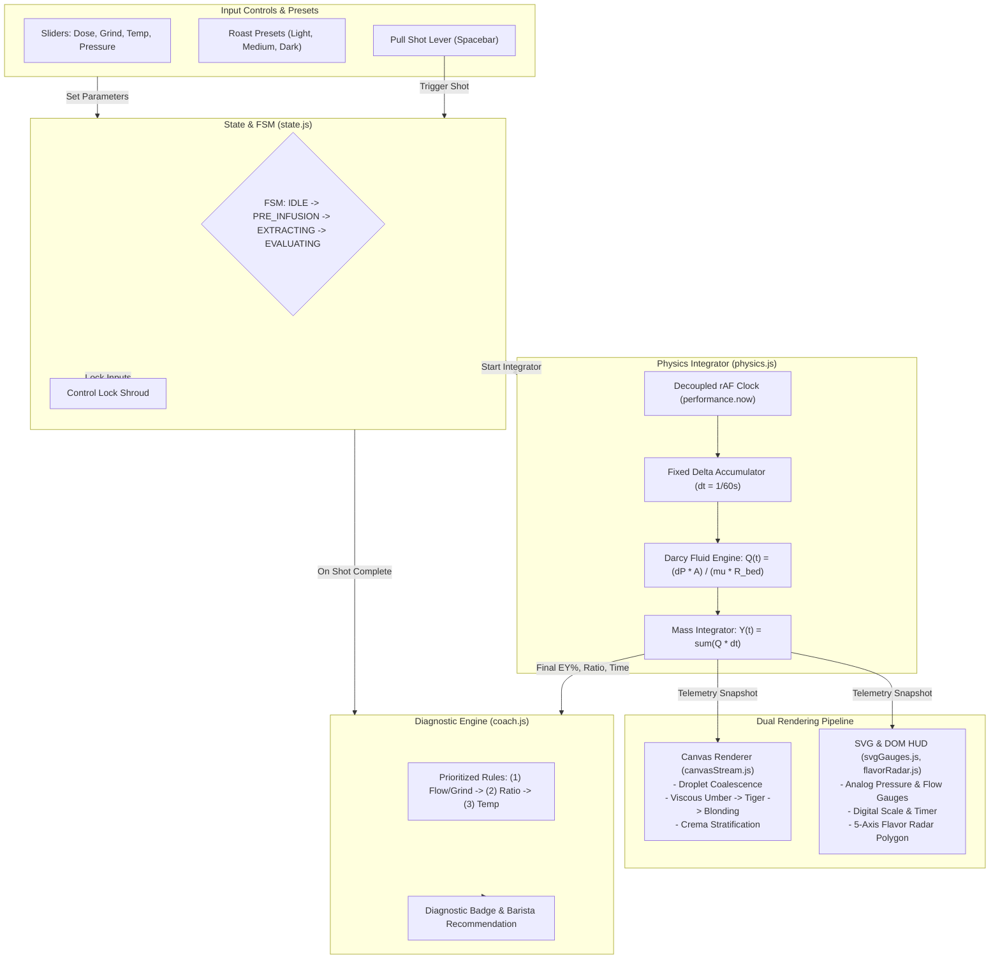
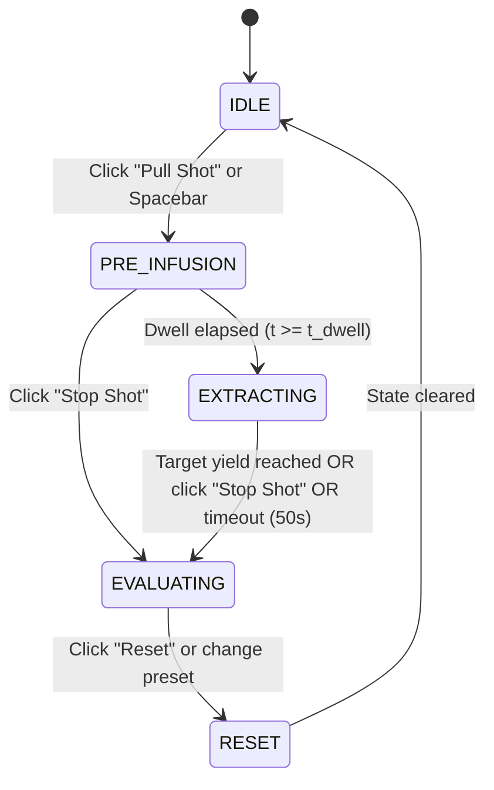
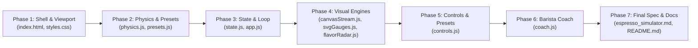

# EspressoLab: Espresso Dial-In Simulator

* **Author:** Vinay Vyas
* **Status:** Draft
* **Date:** 2026-11-06

---

## Overview

EspressoLab is a client-side educational single-page microapplication designed to teach home baristas the fluid dynamics and sensory principles of dialing in espresso. Running entirely in the browser using vanilla JavaScript (ES6+), HTML5 Canvas, SVG, and CSS3, the application requires zero backend services and zero external third-party dependencies.

The simulator models the physical interaction between grind particle size, coffee dose, water temperature, and pump pressure. It computes flow rate and cumulative extraction yield using a discrete frame-integrated porous media resistance model based on Darcy's law. 

The user interface delivers real-time visual feedback across a fixed 1280x850 desktop viewport without scrolling. It pairs an animated Canvas portafilter stream and settling crema cup with SVG telemetry gauges, a dynamic 5-axis flavor radar, and a post-shot diagnostic coach that guides users toward balanced extraction.

---

## The Problem

Dialing in espresso is notoriously difficult for home baristas because extraction is governed by non-linear, coupled physical variables:
1. **Multi-Variable Confusion:** Adjusting grind size, dose, water temperature, or pump pressure simultaneously leads to conflicting sensory outcomes. A shot can run fast yet taste bitter if channeling occurs, or run slowly yet taste sour if water temperature is too low to extract complex sugars.
2. **High Waste and Cost:** Dialing in physical espresso beans requires wasting multiple 18-gram doses of specialty coffee (costing $1.50–$3.00 per shot) and significant time waiting for machine boilers to stabilize.
3. **Black-Box Mental Models:** Commercial espresso machines display basic pressure or time, but conceal fluid velocity, dynamic bed compaction, and chemical solubles dissolution. Novices lack an intuitive visual model connecting bed resistance to flavor balance.

EspressoLab solves this by providing a deterministic, zero-cost virtual laboratory where baristas test dial-in hypotheses instantly, observing fluid dynamics and flavor trade-offs in real time.

---

## Goals

* **Deterministic Physical Modeling:** Implement an algebraic, discrete frame-integrated porous bed extraction engine based on Darcy's law, accurately simulating:
  1. Pre-infusion saturation delay ($4–6\text{s}$ zero flow while pressure ramps).
  2. Steady peak extraction governed by grind size and dose compaction.
  3. Late-shot blonding and hydraulic bed erosion ($15\text{s}+$ resistance decay).
* **Mass-Conserved Real-Time Telemetry:** Decouple the numerical physics accumulator ($\Delta t = 1/60\text{s}$) from display refresh rates, guaranteeing that cumulative cup yield $Y(t)$ strictly equals the discrete integral of flow rate $\sum Q(t) \cdot \Delta t$ down to $\pm 0.01\text{g}$.
* **Dual-Layer Rendering Pipeline:**
  1. HTML5 Canvas dedicated exclusively to 60 FPS fluid rendering: portafilter stream coalescence, droplet detachment, color gradient shifts (dark umber $\rightarrow$ golden tiger stripes $\rightarrow$ blonding), and stratified crema accumulation.
  2. Native SVG and DOM elements for precision telemetry gauges (Pressure bar, Flow rate g/s, Extraction Yield EY%, Shot timer), an interactive 5-axis flavor radar polygon, and parameter sliders.
* **Deterministic 5-Axis Flavor Radar:** Map Extraction Yield ($EY\%$), Brew Ratio ($Y/\text{Dose}$), Water Temperature ($T$), and Shot Time to normalized sensory axes: Sour, Bitter, Body, Sweetness, and Clarity, centered on a target sweet spot of $18–22\% \text{ EY}$ at a $1:2.0$ ratio in $25–30\text{s}$ at $93^\circ\text{C}$.
* **Prioritized Barista Coach Diagnostics:** Implement a rule-based post-shot evaluation tree that enforces professional single-variable calibration order:
  1. Flow Rate & Shot Time (Choke vs. Gusher via Grind Size).
  2. Brew Ratio (Ristretto vs. Lungo via Target Yield).
  3. Thermal Tuning (Under-dissolution vs. Scorching via Temperature).
* **Fixed Desktop Viewport Budget:** Confine the complete dashboard inside a $1280 \times 850$ pixel container with zero window scrolling, using an aspect-preserving CSS scale transform for display compatibility.
* **Zero External Dependencies & Zero Backend:** Deployable as static files (`index.html`, `css/styles.css`, `js/**`) with zero npm packages, zero build tooling, and zero server communication.
* **In-Memory Roast Profiles:** Provide three pre-calibrated bean presets (Light Ethiopian, Medium Colombia, Dark Italian Blend) that illustrate distinct hydraulic permeability and extraction kinetics.

---

## Non-Goals

* **No Backend Server or Remote API:** No database, user accounts, cloud telemetry storage, or authentication.
* **No External Libraries or Frameworks:** No React, Vue, D3.js, Chart.js, Tailwind, or utility libraries. All logic uses vanilla ES6+ and standard DOM/Canvas APIs.
* **No Non-Deterministic Micro-Channeling Physics:** Stochastic water jetting, localized puck fracture, and uneven tamping dynamics are excluded to prevent confusing noise in basic dial-in pedagogy.
* **No Persistent Local Storage:** Telemetry and adjustments run in memory; page reload resets the simulator to default initial state.
* **No Mobile Responsive Layout:** Specifically engineered for desktop displays ($1280 \times 850$ container). Mobile touch re-layouts and vertical stacking are out of scope.
* **No Real-World Sensor Hardware Integration:** No Bluetooth scale (Acaia, Felicita) or smart machine telemetry ingestion.

---

## Open Questions

* **Question 1: Canvas Retina High-DPI Scaling Factor**: Should the Canvas buffer explicitly query `window.devicePixelRatio` and scale its backing store ($2\times$ width/height) to ensure sharp fluid droplet rendering on 4K/Retina displays, and what is the exact pixel performance overhead?
* **Question 2: Flavor Radar Dynamic Animation**: Should the flavor radar polygon animate continuously in real time as the shot extracts, or update only upon shot termination to emphasize final cup evaluation?

---

## Critical User Journeys (CUJs)

### CUJ 1: Baseline Dial-In of a Medium Roast Espresso
* **Given**: Simulator is in `IDLE` state with the "Medium Colombia" preset active (18.0g dose, 340 µm grind, 93.0°C temp, 9.0 bar pressure).
* **When**: User clicks "Pull Shot" (or presses Spacebar).
* **Then**: 
  1. Sliders lock under a frosted glass overlay.
  2. Pump pressure ramps to 9 bar; flow remains 0 g/s for 4.5 seconds during pre-infusion saturation.
  3. At $t = 4.5\text{s}$, first droplets emerge from the portafilter Canvas, coalescing into a dark viscous stream.
  4. Stream flows into the cup at $\sim 1.4\text{ g/s}$, lightening to tiger striping and then blonding after 18s.
  5. The shot reaches 36.0g at $t = 27.2\text{s}$ and terminates automatically.
  6. Final telemetry displays: $EY\% = 20.2\%$, Brew Ratio $1:2.0$.
  7. 5-Axis Flavor Radar displays high Sweetness ($85\%$), moderate Body ($65\%$), and balanced Acidity/Bitterness.
  8. Barista Coach badge outputs green: "Balanced Extraction (God Shot)".

### CUJ 2: Troubleshooting a Gushing, Under-Extracted Shot
* **Given**: User adjusts Grind Size to a coarse 460 µm with an 18.0g dose and 9.0 bar pressure.
* **When**: User clicks "Pull Shot".
* **Then**:
  1. Saturation breakthrough occurs rapidly at $t = 2.2\text{s}$.
  2. Output flow spikes to $> 3.2\text{ g/s}$ with a pale, watery stream and weak crema formation.
  3. The cup hits 36.0g yield in only 13.5 seconds.
  4. Final extraction yield calculates low: $EY\% = 14.8\%$.
  5. Flavor radar reflects severe deflection: Sourness spikes to $90\%$, Sweetness collapses to $20\%$, Body is thin ($25\%$).
  6. Barista Coach diagnoses root cause (Priority 1): "Gushing flow detected (13.5s). Surface area insufficient. Action: Grind 2-3 clicks finer."

### CUJ 3: Diagnosing a Choked Puck
* **Given**: User adjusts Grind Size to an ultra-fine 220 µm with a high 21.0g dose.
* **When**: User clicks "Pull Shot".
* **Then**:
  1. Pressure ramps to 9.0 bar and holds; pre-infusion dwell timer extends past 8 seconds without fluid egress.
  2. Tightly restricted droplets fall at $< 0.4\text{ g/s}$ without forming a continuous cone.
  3. At $t = 40\text{s}$, cup mass has reached only 12.0g.
  4. User clicks "Stop Shot" (or timeout triggers).
  5. Flavor radar displays harsh Bitterness and astringency with near-zero sweetness.
  6. Barista Coach diagnoses root cause (Priority 1): "Puck choked (flow restricted). Bed hydraulic resistance excessive. Action: Grind 2 clicks coarser."


---

## Technical Plan

### 1. High-Level Architecture & Component Topology

EspressoLab is structured as a modular, client-side application using standard ES6 modules without bundling tools or transpilation:

```text
/home/vinayvyas/devfest-espressolab-demo/
├── index.html              # Fixed 1280x850 layout, Canvas viewport, SVG telemetry templates
├── css/
│   └── styles.css          # CSS Grid layout, dark roast palette, scale wrapper, frosted glass locks
└── js/
    ├── config/
    │   └── presets.js      # Light, Medium, Dark roast calibration dictionaries
    ├── engine/
    │   ├── physics.js      # Darcy fluid dynamics, viscosity, dynamic bed resistance, discrete accumulator
    │   ├── state.js        # Reactive state manager and FSM transition coordinator
    │   └── coach.js        # Prioritized heuristic rule engine for post-shot diagnosis
    ├── ui/
    │   ├── canvasStream.js # 60 FPS HTML5 Canvas particle/stream/crema renderer
    │   ├── svgGauges.js    # Needle arc geometry and digital HUD dials for Pressure and Flow
    │   ├── flavorRadar.js  # Dynamic 5-axis SVG polygon vertex transformation & sensory scoring
    │   └── controls.js     # DOM slider event handlers, numeric steppers, and preset selectors
    └── app.js              # Application entry point, decoupled rAF render loop, keyboard shortcuts
```

#### System Data Flow Diagram



---

### 2. Extraction Physics & Mathematical Model

#### Darcy Hydraulic Flow Equation
The instantaneous volumetric flow rate $Q(t)$ ($g/s$, assuming aqueous fluid density $\rho \approx 1.0\text{ g/cm}^3$) through the cylindrical coffee puck is modeled by Darcy's law for laminar flow through a porous medium:

$$Q(t) = \frac{\Delta P(t) \cdot A}{\mu(T) \cdot R_{\text{bed}}(t)}$$

Where:
* $\Delta P(t)$: Differential pressure across the bed ($Pa$). When running, $\Delta P(t) = P_{\text{pump}} \times 10^5\text{ Pa}$. During pre-infusion ($0 \le t \le t_{\text{dwell}}$), $\Delta P(t)$ ramps linearly from $0$ to target.
* $A$: Cross-sectional area of a standard commercial 58mm basket:
  $$A = \pi \cdot r^2 = \pi \cdot (0.029\text{ m})^2 \approx 2.642 \times 10^{-3}\text{ m}^2$$
* $\mu(T)$: Dynamic water viscosity ($Pa \cdot s$) modeled as a function of temperature ($T$ in $^\circ\text{C}$):
  $$\mu(T) = 2.414 \times 10^{-5} \times 10^{\frac{247.8}{(T + 273.15) - 140}}\text{ Pa}\cdot\text{s}$$
  (At $93^\circ\text{C}$, $\mu \approx 3.04 \times 10^{-4}\text{ Pa}\cdot\text{s}$, approximately $3\times$ less viscous than at room temperature, promoting faster flow).

#### Hydraulic Bed Resistance & Dynamic Erosion
Puck resistance $R_{\text{bed}}(t)$ combines initial bed compaction $R_0$ with time-dependent soluble washout erosion:

1. **Initial Bed Resistance ($R_0$):**
   $$R_0 = k_{\text{grain}} \cdot \frac{\text{Dose}^{1.25}}{(\text{GrindMicrons})^{2.6}}$$
   Where $k_{\text{grain}}$ is an empirical resistance scaling constant calibrated to yield $1.4\text{ g/s}$ at 340 µm, 18g dose, and 9 bar.
2. **Puck Saturation & Absorption Dwell ($t_{\text{dwell}}$):**
   Water must saturate the compressed dry coffee bed before liquid egress occurs. The saturation dwell time is calculated as:
   $$t_{\text{dwell}} = k_{\text{dwell}} \cdot \frac{\text{Dose}}{\text{GrindMicrons}} \cdot \left(\frac{9.0}{P_{\text{pump}}}\right)^{0.5}$$
   Typically $4.0 - 5.5\text{s}$ for an 18g dose. During $0 \le t < t_{\text{dwell}}$:
   $$Q(t) = 0.0\text{ g/s}$$
   The puck absorbs approximately $1.2 \times \text{Dose}$ grams of water before breakthrough.
3. **Late Blonding & Hydraulic Resistance Decay:**
   As coffee solubles dissolve into solution (up to $28\%$ of dry coffee mass), internal pores widen, decreasing hydraulic resistance:
   $$R_{\text{bed}}(t) = R_0 \cdot \left[1 - \beta \cdot \left(\frac{Y(t)}{\text{Dose}}\right)\right]^2$$
   Where $\beta \approx 0.28$ is the soluble erosion coefficient, and $Y(t)$ is cumulative cup yield in grams. As $Y(t)$ climbs from $0$ to $36\text{g}$, $R_{\text{bed}}$ drops by approximately $25\%$, causing the physical flow rate $Q(t)$ to naturally accelerate from $1.3\text{ g/s}$ to $> 2.2\text{ g/s}$ in the late stage.

#### Decoupled Fixed-Step Integration Loop
To guarantee mass conservation and identical behavior on 60Hz, 120Hz, and 144Hz displays, `app.js` runs a fixed delta time accumulator:

```javascript
// Fixed physics simulation step: 60Hz (16.667ms)
const PHYSICS_DT = 1 / 60;
let accumulator = 0;
let lastTime = performance.now();

function animationFrame(currentTime) {
  const frameDelta = Math.min((currentTime - lastTime) / 1000, 0.1); // Clamp to 100ms max
  lastTime = currentTime;
  accumulator += frameDelta;

  while (accumulator >= PHYSICS_DT) {
    physicsEngine.step(PHYSICS_DT);
    accumulator -= PHYSICS_DT;
  }

  canvasStream.render(physicsEngine.getRenderSnapshot());
  svgGauges.update(physicsEngine.getTelemetrySnapshot());
  
  if (stateManager.isRunning()) {
    requestAnimationFrame(animationFrame);
  }
}
```

**Mass Conservation Guarantee:**
$$Y(t + \Delta t) = Y(t) + Q(t) \cdot \Delta t$$
Cup yield is an exact accumulation of physical flow slices. Quantization to $0.01\text{g}$ eliminates floating-point rounding errors.

---

### 3. Dual-Layer Visual Rendering Subsystem

#### HTML5 Canvas Portafilter & Stream Renderer (`canvasStream.js`)
The Canvas occupies a $460 \times 440\text{px}$ central stage:
1. **Portafilter Basket Head:** Static metallic basket rendering with bottomless perforated filter plate.
2. **Droplet Detachment & Cone Coalescence:**
   * At $t = t_{\text{dwell}}$, 8–12 localized micro-beads of dark espresso swell on the bottom basket plate.
   * Droplets accelerate downward under simulated gravity, coalescing via quadratic Bezier paths into a unified central cone stream.
3. **Dynamic Stream Color Gradation (Tiger Striping & Blonding):**
   Fluid color interpolates dynamically based on instantaneous soluble concentration $C_{\text{sol}}(t)$:
   * Initial ($C_{\text{sol}} > 10\%$): Viscous dark mahogany umber (`rgba(43, 24, 16, 0.95)`).
   * Mid-Shot ($5\% < C_{\text{sol}} \le 10\%$): Rich caramel with turbulent golden tiger-striping swirls (`rgba(160, 82, 45, 0.9)`).
   * Late Blonding ($C_{\text{sol}} < 5\%$): Translucent straw amber (`rgba(222, 184, 135, 0.65)`).
4. **Volumetric Cup & Crema Foam Stratification:**
   * Liquid espresso accumulates in a clear glass cup at the base.
   * A persistent crema foam head sits atop the liquid, growing in thickness during high-pressure extraction ($6–8\text{mm}$) and slowly degassing/settling post-shot.

#### SVG Telemetry & Dials (`svgGauges.js`)
* **Radial Gauges:** Dual semi-circular analog needle dials for Pump Pressure ($0–14\text{ bar}$) and Flow Rate ($0–5\text{ g/s}$). Needles are rotated via SVG `transform="rotate(deg, cx, cy)"`.
* **Digital Readouts:** High-contrast tabular numbers (`font-variant-numeric: tabular-nums;`) for Shot Elapsed Time (`00.0s`), Yield (`00.0g`), and Real-time EY% (`00.0%`).

#### SVG 5-Axis Flavor Radar (`flavorRadar.js`)
The flavor radar renders a pentagonal coordinate grid with 5 vertices radiating from center $(cx, cy) = (140, 140)$ with radius $R = 100\text{px}$ at $72^\circ$ intervals:
* **Vertex 0 ($90^\circ$ - Top):** Sourness
* **Vertex 1 ($18^\circ$ - Upper Right):** Sweetness
* **Vertex 2 ($306^\circ$ - Lower Right):** Body
* **Vertex 3 ($234^\circ$ - Lower Left):** Bitterness
* **Vertex 4 ($162^\circ$ - Upper Left):** Clarity

**Sensory Mapping Formulation:**
Each sensory axis is normalized between $0.0$ and $1.0$:
* **Sourness ($S$):**
  $$S = \text{clamp}\left(1.0 - \frac{EY - 12}{8}, 0.05, 1.0\right) \times \left(1.0 + 0.5 \cdot \max(0, \frac{91 - T}{10})\right)$$
* **Bitterness ($B$):**
  $$B = \text{clamp}\left(\frac{EY - 18}{6}, 0.05, 1.0\right) \times \left(1.0 + 0.4 \cdot \max(0, \frac{T - 94}{10})\right)$$
* **Body ($D$):**
  $$D = \text{clamp}\left(\frac{\text{Dose}}{20} \times \frac{1.9}{\text{Ratio}}, 0.1, 1.0\right)$$
* **Sweetness ($W$):**
  $$W = \exp\left(-\frac{(EY - 20.0)^2}{2 \times (1.8)^2}\right) \times \exp\left(-\frac{(T - 93.0)^2}{2 \times (2.0)^2}\right)$$
* **Clarity ($C$):**
  $$C = \text{clamp}\left(\frac{\text{Ratio} - 1.6}{0.8} \times (1.0 - 0.4 \cdot D), 0.1, 1.0\right)$$

*Faint Target Ghost Band:* A translucent gold polygon marks the optimal balanced profile ($S=0.35, W=0.90, D=0.65, B=0.30, C=0.70$) for immediate visual comparison.

---

### 4. Finite State Machine (FSM) & Lifecycle



1. **`IDLE`**: Controls unlocked. User can select roast presets or drag sliders. Gauges zeroed.
2. **`PRE_INFUSION`**: Controls locked under frosted glass shroud (`pointer-events: none; opacity: 0.6;`). Pump engages, pressure rises to target. Stream Canvas displays swelling beads on basket underside. Output flow is $0\text{ g/s}$.
3. **`EXTRACTING`**: Droplets detach into continuous stream. Scale yield accumulates. Gauges register active flow rate.
4. **`EVALUATING`**: Shot concludes. Freeze final flow curve. Trigger `coach.js` diagnostic evaluation. Render post-shot badge, numeric score, and flavor radar polygon.
5. **`RESET`**: Reset physics accumulator, clear Canvas and graph buffers, unlock sliders.

---

### 5. Barista Coach Diagnostic Decision Tree

The Barista Coach evaluates extraction metrics post-shot using a strict 3-tier precedence ladder:

```text
Step 1: Check Hydraulic Flow & Shot Time (Priority 1: Grind Size)
├─ IF Total Shot Time < 22.0s (for 1:2 ratio) OR Average Flow > 2.6 g/s:
│  └─ DIAGNOSIS: "Gushing Flow / Under-Extracted"
│     ACTION: "Grind 2 to 3 clicks finer. Increase bed resistance to slow extraction."
│
├─ IF Total Shot Time > 35.0s OR Choked (Yield < Target at 40s):
│  └─ DIAGNOSIS: "Puck Choked / Over-Extracted"
│     ACTION: "Grind 2 clicks coarser to alleviate excessive bed compaction."
│
└─ ELSE (Flow in Normal Window: 24.0s - 32.0s):
   │
   Step 2: Check Brew Ratio Balance (Priority 2: Yield)
   ├─ IF Brew Ratio < 1:1.85:
   │  └─ DIAGNOSIS: "Tight Ristretto / Acid Dominant"
   │     ACTION: "Increase target yield to 1:2.0 to extract balancing sugars."
   │
   ├─ IF Brew Ratio > 1:2.35:
   │  └─ DIAGNOSIS: "Over-Extended Lungo / Hollow"
   │     ACTION: "Cut shot earlier at 1:2.0 to avoid late-stage blonding bitterness."
   │
   └─ ELSE (Ratio in Target Window: 1:1.9 - 1:2.2):
      │
      Step 3: Check Thermal Optimization (Priority 3: Water Temp)
      ├─ IF Water Temp < 91.5°C AND EY% < 19.0%:
      │  └─ DIAGNOSIS: "Low Temperature Stifling Extraction"
      │     ACTION: "Raise water temperature to 93.0°C - 94.0°C to dissolve complex sucrose."
      │
      ├─ IF Water Temp > 95.0°C AND Bitterness > 0.65:
      │  └─ DIAGNOSIS: "Thermal Scorching / Astringency"
      │     ACTION: "Lower temperature to 92.5°C to avoid scorching delicate solubles."
      │
      └─ ELSE:
         └─ DIAGNOSIS: "Balanced Extraction (God Shot)"
            ACTION: "Dial-in perfect! Symmetrical flavor profile with sweet lingering finish."
```

---

### 6. Viewport Budgeting (1280x850 Layout)

```text
+----------------------------------------------------------------------------------------------------+ [1280px]
|  [Logo] EspressoLab  |  Presets: [Light Ethiopia] [Medium Colombia] [Dark Italian]   | [Reset All] | (50px)
+------------------------------------+-------------------------------+-------------------------------+
|  INPUT CONTROLS (320px)            |  EXTRACTION STAGE (460px)     |  TELEMETRY & RADAR (480px)    |
|                                    |                               |                               |
|  Dose:         [ 18.0 g ] [-][+]   |    [ ===== PORTAFILTER ===== ]|  (Gauge 1)        (Gauge 2)   |
|  ======[]=================         |              \       /        |   Pressure         Flow Rate  |
|                                    |               \     /         |   [ 9.0 bar ]     [ 1.4 g/s ] |
|  Grind:        [ 340 um ] [-][+]   |                ||             |                               |
|  ========[]===============         |                || Stream      |  ---------------------------  | (540px)
|                                    |                \/             |  5-AXIS FLAVOR RADAR          |
|  Water Temp:   [ 93.0 C ] [-][+]   |          +-----------+        |             Sour              |
|  ===========[]============         |          | ~ Crema ~ |        |              /\               |
|                                    |          |  Espresso |        |     Clarity /  \ Sweetness    |
|  Pump Pressure:[ 9.0 bar] [-][+]   |          +-----------+        |            |    |             |
|  ===========[]============         |             [ Scale ]         |             \  /              |
|                                    |            [ 36.0 g ]         |         Bitter  Body          |
|  [ >>> PULL SHOT (SPACE) <<< ]     |                               |                               |
+------------------------------------+-------------------------------+-------------------------------+
|  BARISTA COACH CARD (500px)                                |  EXTRACTION GRAPH HUD (780px)         |
|  Badge: BALANCED EXTRACTION                                |  Yield (g) & Flow Rate (g/s) vs Time  | (260px)
|  * Extraction Yield: 20.2%  |  Brew Ratio: 1:2.0           |  [--- Actual Yield Curve            ] |
|  * Diagnosis: Perfectly dialed-in espresso.                |  [... Ghost Target Zone             ] |
|  * Action: No adjustments needed. Enjoy your coffee!       |                                       |
+------------------------------------------------------------+---------------------------------------+ [850px]
```


---

## Alternatives Considered

### Alternative 1: Offloading Physics Simulation to a WebWorker Thread
* **Pros**: Isolates physics execution from the main browser UI thread; guarantees tick execution even during heavy DOM layout recalculations.
* **Cons**: Introduces asynchronous messaging latency; requires structured serialization (`postMessage`) for telemetry state 60 times per second; breaks zero-dependency single-file/vanilla module simplicity.
* **Reason for Rejection**: Rejected by author: The discrete Darcy numerical integration model executes in under $0.05\text{ms}$ per tick. Thread context switching and data serialization overhead exceed the execution cost of the math itself, adding architectural friction without measurable UI thread relief.

### Alternative 2: Single Full-Screen HTML5 Canvas Surface
* **Pros**: Zero DOM overhead; unified render loop; seamless GPU rasterization.
* **Cons**: Text rendering and typography lose crisp subpixel antialiasing on high-DPI screens; eliminates native browser form control accessibility (ARIA, keyboard navigation for sliders); requires custom implementations of sliders, buttons, tooltips, and hover hit-testing.
* **Reason for Rejection**: Rejected by author: Canvas is poorly suited for form controls and crisp vector telemetry. Decoupling dynamic fluid particles (Canvas) from dials and sliders (SVG/DOM) delivers optimal visual quality and accessibility.

### Alternative 3: Full SVG/DOM Animation for Fluid Streams and Crema Head
* **Pros**: Declarative styling via CSS; scalable vector resolution at all zoom levels; DOM inspector debuggability.
* **Cons**: Spawning, animating, and removing 50–100 droplets and fluid paths per second at 60 FPS triggers severe layout recalculations, style recalcs, and garbage collection pauses in browser rendering engines.
* **Reason for Rejection**: Rejected by author: High-frequency fluid particles and crema foam textures cause browser DOM thrashing. Canvas 2D immediate-mode rendering handles particle pools with zero garbage collection allocations.

### Alternative 4: Pure Closed-Form Algebraic Flow Formula (Non-Integrated)
* **Pros**: Trivial implementation ($Q = f(t)$); zero state accumulator needed; arbitrary random access to shot timestamps.
* **Cons**: Fails mass conservation; discrepancies accumulate between instantaneous flow rate $Q(t)$ and cup yield scale telemetry $Y(t)$ unless complex symbolic integrals are evaluated for every non-linear parameter curve.
* **Reason for Rejection**: Rejected by author: Educational realism requires that the cup mass displayed on the digital scale strictly represents the physical integral of flow rate over time ($\int Q dt = Y$).

### Alternative 5: Stochastic Micro-Channeling and Puck Defect Simulation
* **Pros**: High physical fidelity matching real-world unpressurized basket inconsistencies, puck cracking, and uneven tamping.
* **Cons**: Introduces random, non-reproducible variance into shot outcomes; users cannot cleanly deduce whether a sour shot was caused by grind size or random channeling.
* **Reason for Rejection**: Rejected by author: EspressoLab is primarily an educational mental model accelerator. Deterministic cause-and-effect allows home baristas to master multi-variable relationships without confusing stochastic noise.

### Alternative 6: Unordered Multi-Variable Barista Coach Diagnostics
* **Pros**: Reports every suboptimal parameter in a single diagnostic summary card.
* **Cons**: Overwhelms the user with conflicting corrective actions (e.g., "Grind finer, decrease ratio, raise temp, lower pressure" all at once). Violates standard barista calibration methodology.
* **Reason for Rejection**: Rejected by author: Commercial barista dial-in protocols mandate single-variable iteration in order of physical dominance: first establish flow rate via grind size, then adjust brew ratio, then fine-tune temperature.


---

## Detailed Implementation Plan

### 1. File Inventory & Modification Rationale

| File Path | Action | Rationale |
| :--- | :--- | :--- |
| `index.html` | Create | Root document housing the single-page application structure. Declares the fixed $1280 \times 850$ container, the 2D Canvas viewport for fluid rendering, inline SVG definitions for radial needle dials and the 5-axis flavor radar, input slider controls, and the post-shot Barista Coach card. |
| `css/styles.css` | Create | Establishes the CSS Grid layout, desktop-first 1280x850 viewport confinement, responsive CSS scale transform, dark espresso/amber visual theme, custom slider thumb styles, and the frosted-glass control lock overlay (`pointer-events: none`). |
| `js/config/presets.js` | Create | In-memory calibration dictionaries defining default parameter profiles for Light Ethiopian, Medium Colombia, and Dark Italian roasts (dose, grind microns, water temp, pump pressure, and target yield). |
| `js/engine/physics.js` | Create | Core physical simulation engine. Encapsulates Darcy's law for porous media, temperature-dependent dynamic viscosity $\mu(T)$, pre-infusion dwell delay, initial bed compaction resistance $R_0$, late-shot soluble erosion decay $R_{\text{bed}}(t)$, and fixed-delta numerical accumulator stepping. |
| `js/engine/state.js` | Create | Central reactive state store and Finite State Machine (FSM). Manages state transitions (`IDLE`, `PRE_INFUSION`, `EXTRACTING`, `EVALUATING`, `RESET`), locks/unlocks inputs, records time-series telemetry snapshots, and notifies UI subscribers. |
| `js/engine/coach.js` | Create | Deterministic diagnostic heuristic engine. Evaluates shot telemetry post-extraction against a 3-tier prioritized decision tree (1. Flow/Grind, 2. Brew Ratio, 3. Water Temp), generating diagnostic badges, taste descriptors, and corrective actions. |
| `js/ui/canvasStream.js` | Create | 60 FPS HTML5 Canvas animation subsystem. Handles portafilter basket head rendering, droplet bead swelling during pre-infusion, converging fluid stream cone, instantaneous color interpolation (viscous umber $\rightarrow$ tiger striping $\rightarrow$ blonding), and volumetric crema/liquid cup accumulation. |
| `js/ui/svgGauges.js` | Create | Manages SVG needle rotation math for the Pump Pressure ($0–14\text{ bar}$) and Flow Rate ($0–5\text{ g/s}$) dials, along with high-contrast digital tabular readouts for Elapsed Time, Cup Mass, and instantaneous Extraction Yield (EY%). |
| `js/ui/flavorRadar.js` | Create | Computes 5-axis sensory coordinates (Sour, Bitter, Body, Sweetness, Clarity) from final extraction metrics, renders the dynamic SVG polygon path on a $72^\circ$ radial grid, and overlays the static golden target zone. |
| `js/ui/controls.js` | Create | Binds input sliders, numeric increment/decrement buttons, preset selector tabs, the "Pull Shot" / "Stop Shot" trigger lever, Spacebar keyboard shortcuts, and toggle states for the frosted-glass lock shroud. |
| `js/app.js` | Create | Application bootstrap script. Instantiates modules, manages the decoupled `requestAnimationFrame` loop with fixed 60Hz physics accumulation, registers window resize aspect-ratio scaling, and coordinates teardown/reset lifecycles. |
| `docs/designs/espresso_simulator.md` | Create | Canonical design specification and product requirements document (PRD) finalized from this design draft. |
| `README.md` | Create | Repository documentation detailing dial-in physics principles, application architecture, local execution instructions, and keyboard navigation guides. |

---

### 2. Module Interface & Contract Specifications

#### `js/config/presets.js`
* **Exports**:
  * `ROAST_PRESETS`: Dictionary indexed by `'light' | 'medium' | 'dark'` containing:
    * `name`: string
    * `dose`: number (grams, 14.0–22.0)
    * `grind`: number (microns, 200–500)
    * `temperature`: number (°C, 88.0–96.0)
    * `pressure`: number (bar, 6.0–12.0)
    * `targetYield`: number (grams, 28.0–55.0)
    * `dwellMultiplier`: number (cellular density adjustment factor)
    * `description`: string

#### `js/engine/physics.js`
* **Class**: `PhysicsEngine`
  * `constructor(config)`: Initializes state vectors, constants (basket area $A = 2.642 \times 10^{-3}\text{ m}^2$, erosion coefficient $\beta = 0.28$, grain constant $k_{\text{grain}}$).
  * `reset(params)`: Resets accumulator, elapsed time $t = 0$, yield $Y = 0$, current flow $Q = 0$, and pre-computes $R_0$, $t_{\text{dwell}}$, and $\mu(T)$.
  * `step(dt)`: Advances the simulation by fixed $\Delta t$ ($1/60\text{s}$):
    * Computes active pressure $\Delta P(t)$ (ramping during $t < t_{\text{dwell}}$, constant pump pressure during extraction).
    * Computes dynamic resistance $R_{\text{bed}}(t)$ based on current yield ratio $Y(t)/\text{Dose}$.
    * Computes flow rate $Q(t) = (\Delta P \cdot A) / (\mu \cdot R_{\text{bed}})$. If $t < t_{\text{dwell}}$, $Q(t) = 0$.
    * Integrates yield: $Y(t + \Delta t) = Y(t) + Q(t) \cdot \Delta t$.
    * Computes instantaneous Extraction Yield $EY\%(t)$ and Total Dissolved Solids $TDS\%(t)$.
  * `getTelemetry()`: Returns snapshot object `{ time, yield, flowRate, pressure, ey, tds, phase, blondingFraction }`.

#### `js/engine/state.js`
* **Class**: `StateManager`
  * State constants: `STATES = { IDLE: 'IDLE', PRE_INFUSION: 'PRE_INFUSION', EXTRACTING: 'EXTRACTING', EVALUATING: 'EVALUATING' }`.
  * `subscribe(event, callback)`: Pub/Sub event dispatcher for UI updates (`'stateChange'`, `'telemetryTick'`, `'shotComplete'`).
  * `transitionTo(nextState)`: Validates transition rules and emits `'stateChange'` with current parameters.
  * `setParameters(newParams)`: Updates active input parameters (dose, grind, temp, pressure, targetYield) with validation clamping.
  * `recordTelemetryPoint(point)`: Appends data point to time-series history buffer for the extraction chart.

#### `js/engine/coach.js`
* **Function**: `evaluateShot(metrics)`:
  * Accepts: `{ dose, grind, temperature, pressure, yield, shotTime, ey, ratio }`.
  * Returns: `{ badgeClass: string, badgeText: string, title: string, diagnosis: string, action: string, tasteNotes: string[] }`.
  * Implements the 3-tier priority ladder (Grind/Flow $\rightarrow$ Brew Ratio $\rightarrow$ Temperature).

#### `js/ui/canvasStream.js`
* **Class**: `CanvasStreamRenderer`
  * `constructor(canvasElement)`: Binds 2D rendering context, sets backing resolution based on `devicePixelRatio`, initializes stream particle pools and crema simulation buffers.
  * `render(telemetry, params)`: 
    * Clears frame buffer.
    * Renders 58mm stainless bottomless portafilter rim and perforated basket screen.
    * Renders pre-infusion droplet bead swelling when `phase === 'PRE_INFUSION'`.
    * Renders central quadratic Bezier cone stream with dynamic width $w \propto \sqrt{Q(t)}$ and color gradient interpolation based on `blondingFraction`.
    * Renders collection cup liquid fill height and top crema foam layer with micro-bubble texturing.
  * `reset()`: Flushes particles and resets liquid/crema levels to zero.

#### `js/ui/svgGauges.js`
* **Class**: `SVGGaugeManager`
  * `constructor(domRefs)`: Caches SVG elements (pressure needle, flow needle, digital text spans).
  * `update(telemetry)`:
    * Rotates pressure needle across arc $-120^\circ$ to $+120^\circ$ ($0–14\text{ bar}$).
    * Rotates flow needle across arc $-120^\circ$ to $+120^\circ$ ($0–5\text{ g/s}$).
    * Updates digital readout strings for elapsed time (`00.0s`), cup weight (`00.0g`), and extraction yield (`00.0%`).

#### `js/ui/flavorRadar.js`
* **Class**: `FlavorRadarRenderer`
  * `constructor(svgPolygonElement, ghostPolygonElement)`: Sets up geometry constants (radius $R = 100\text{px}$, center $140, 140$).
  * `renderGhostTarget()`: Renders static faint golden polygon for balanced profile.
  * `update(metrics)`: Computes normalized values $[0.0, 1.0]$ for Sour, Sweet, Body, Bitter, and Clarity using sensory equations, converts polar coordinates to Cartesian $(x_i, y_i)$, and updates SVG `points` attribute with animated CSS transition.

#### `js/ui/controls.js`
* **Class**: `ControlsManager`
  * `constructor(stateManager)`: Attaches input listeners for sliders (`input` event for real-time display, `change` event for state commit), stepper buttons (`+` and `-`), preset tabs, and the primary "Pull Shot" lever button.
  * `lockControls(isLocked)`: Toggles CSS class `.controls-locked` on the control panel, displaying the frosted-glass shroud.
  * `setPullButtonState(mode)`: Switches button between `'PULL_SHOT'` (primary amber) and `'STOP_SHOT'` (active crimson).

#### `js/app.js`
* **Script**:
  * Initializes state, physics, rendering, gauges, radar, and control managers.
  * Binds global keyboard shortcuts: `Spacebar` triggers Pull/Stop Shot, `R` triggers Reset, `1/2/3` select presets.
  * Manages high-resolution `requestAnimationFrame` loop with fixed-step accumulation (`accumulator += frameDelta; while(accumulator >= 1/60) physics.step(1/60);`).
  * Implements `handleWindowResize()`: Dynamically calculates scale factor `min(window.innerWidth / 1280, window.innerHeight / 850)` and applies `transform: scale(s)` on `#app-viewport`.

---

### 3. Step-by-Step Execution Sequence



1. **Phase 1: Layout & Viewport Foundation**
   * Construct `index.html` with fixed $1280 \times 850$ semantic structure (Header, Left Control Rail, Center Canvas Stage, Right Telemetry & Radar, Lower Diagnostic Deck).
   * Construct `css/styles.css` establishing CSS Grid, dark espresso palette, custom range sliders, frosted lock overlay, and aspect-scale container.
2. **Phase 2: Mathematical Modeling & Roast Presets**
   * Implement `js/config/presets.js` with validated roast parameter presets (Light, Medium, Dark).
   * Implement `js/engine/physics.js` with Darcy porous bed equations, dynamic viscosity $\mu(T)$, initial grain resistance $R_0$, dwell saturation delay, late-shot erosion, and discrete fixed-delta accumulator.
3. **Phase 3: State Machine & Execution Clock**
   * Implement `js/engine/state.js` with FSM states, parameter clamping, and telemetry time-series logging.
   * Implement `js/app.js` with decoupled `requestAnimationFrame` loop stepping physics at 60Hz.
4. **Phase 4: Dual-Layer Rendering Subsystem**
   * Implement `js/ui/canvasStream.js` for 60 FPS portafilter stream coalescence, droplet detachment, color gradient interpolation (viscous umber $\rightarrow$ tiger striping $\rightarrow$ blonding), and crema cup fill.
   * Implement `js/ui/svgGauges.js` for radial needle rotation and digital HUD readouts.
   * Implement `js/ui/flavorRadar.js` for 5-axis pentagonal sensory coordinate transformation and target ghost overlay.
5. **Phase 5: Controls, Presets & Locking**
   * Implement `js/ui/controls.js` to wire sliders, stepper buttons, preset tabs, spacebar shortcut, and control locking.
6. **Phase 6: Barista Coach Rule Engine**
   * Implement `js/engine/coach.js` with 3-tier diagnostic ladder (Grind/Flow $\rightarrow$ Brew Ratio $\rightarrow$ Water Temp).
7. **Phase 7: Verification & Documentation**
   * Generate canonical specification at `docs/designs/espresso_simulator.md`.
   * Create `README.md` with physical extraction model documentation and usage guidelines.
