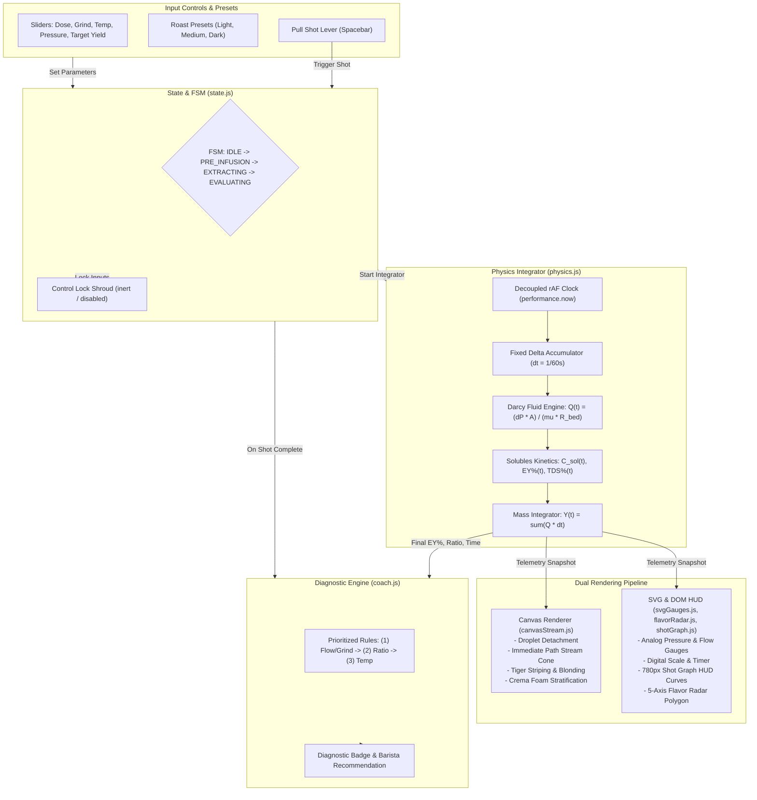
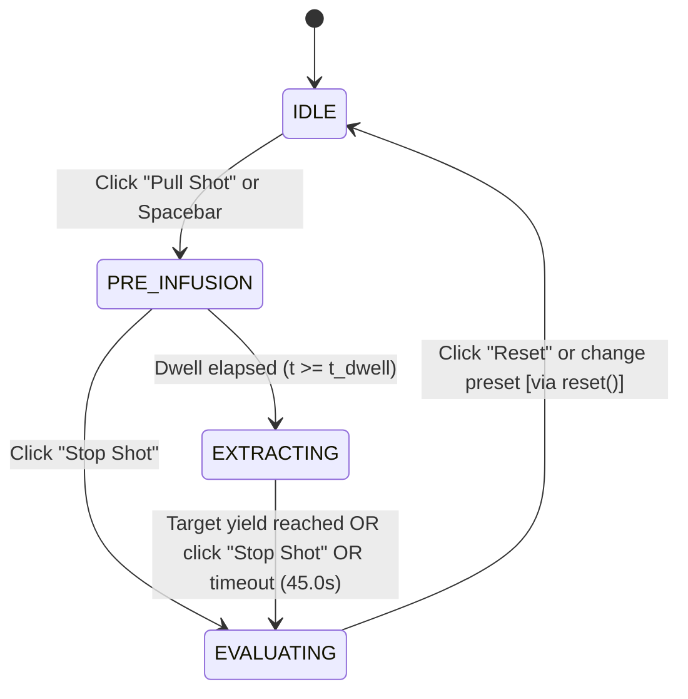
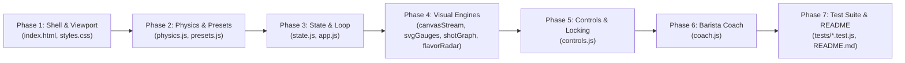

# EspressoLab: Espresso Dial-In Simulator

* **Author:** Vinay Vyas
* **Status:** Approved (Remediated)
* **Date:** 2026-11-06

---

## Overview

EspressoLab is a client-side educational single-page microapplication designed to teach home baristas the fluid dynamics and sensory principles of dialing in espresso. Running entirely in the browser using vanilla JavaScript (ES6+), HTML5 Canvas, SVG, and CSS3, the application requires zero backend services and zero external third-party dependencies.

The simulator models the physical interaction between grind particle size, coffee dose, water temperature, pump pressure, and target liquid yield. It computes flow rate, cumulative extraction yield, total dissolved solids, and blonding dynamics using a discrete frame-integrated porous media resistance model based on Darcy's law. 

The user interface delivers real-time visual feedback across a fixed 1280x850 desktop viewport without scrolling. It pairs an animated Canvas portafilter stream and settling crema cup with SVG telemetry gauges, a dynamic SVG extraction curve HUD, a 5-axis flavor radar, and a post-shot diagnostic coach that guides users toward balanced extraction.

### Technical & Coffee Domain Glossary

| Term | Domain | Definition & Technical Relevance |
| :--- | :---: | :--- |
| **EY% (Extraction Yield)** | Coffee Chemistry | The percentage of coffee grounds mass dissolved into the beverage: $EY\% = (\text{Solubles Mass} / \text{Dose}) \times 100\%$. The Specialty Coffee Association (SCA) target sweet spot is $18.0\%–22.0\%$. |
| **TDS% (Total Dissolved Solids)** | Coffee Chemistry | The concentration of soluble coffee solids in the brewed cup: $TDS\% = (\text{Solubles Mass} / \text{Cup Yield}) \times 100\%$. Typical espresso ranges from $8.0\%–12.0\%$. |
| **Blonding** | Sensory / Visual | The visual transition during extraction when dense, dark-brown crema gives way to a pale, translucent, watery stream as soluble sugars and solids deplete. |
| **Tiger Striping** | Sensory / Visual | Distinct mottled dark and golden-amber streaks in freshly pulled crema, resulting from stable emulsion of micro-bubbles, colloidal lipids, and insoluble fines. |
| **God Shot** | Barista Industry | An industry term describing a perfectly balanced espresso extraction possessing optimal sweetness, velvety body, complex acidity, and a lingering cocoa finish. |
| **Ristretto / Lungo** | Brewing Ratio | A restricted short brew ratio ($1:1.0–1:1.5$) characterized by dense body and high acidity, versus an extended long brew ratio ($1:2.5–1:3.0$) characterized by higher extraction and potential bitterness. |
| **rAF** | Browser API | `window.requestAnimationFrame()`, the browser mechanism used to synchronize visual updates with display refresh rates (60Hz/120Hz/144Hz) decoupled from fixed physics stepping. |

---

## The Problem

Dialing in espresso is notoriously difficult for home baristas because extraction is governed by non-linear, coupled physical variables:
1. **Multi-Variable Confusion:** Adjusting grind size, dose, water temperature, or pump pressure simultaneously leads to conflicting sensory outcomes. A shot can run fast yet taste bitter if channeling occurs, or run slowly yet taste sour if water temperature is too low to extract complex sugars.
2. **High Waste and Cost:** Dialing in physical espresso beans requires wasting multiple 18-gram doses of specialty coffee (costing $1.50–$3.00 per shot) and significant time waiting for machine boilers to stabilize.
3. **Black-Box Mental Models:** Commercial espresso machines display basic pressure or time, but conceal fluid velocity, dynamic bed compaction, and chemical solubles dissolution. Novices lack an intuitive visual model connecting bed resistance to flavor balance.

EspressoLab solves this by providing a deterministic, zero-cost virtual laboratory where baristas test dial-in hypotheses instantly, observing fluid dynamics and flavor trade-offs in real time.

---

## Goals

* **Deterministic Physical Modeling:** Implement an algebraic, discrete frame-integrated porous bed extraction engine based on Darcy's law, accurately simulating:
  1. Pre-infusion saturation delay ($4–6\text{s}$ zero flow while bed saturates and pressure ramps).
  2. Steady peak extraction governed by grind size and dose compaction resistance.
  3. Late-shot blonding and hydraulic bed erosion ($15\text{s}+$ resistance decay clamped to a physical floor of $0.25 R_0$).
* **Soluble Dissolution Kinetics:** Model real-time extraction yield ($EY\%$), total dissolved solids ($TDS\%$), and dynamic stream color interpolation using an empirical exponential washout proxy.
* **Mass-Conserved Real-Time Telemetry:** Decouple the numerical physics accumulator ($\Delta t = 1/60\text{s}$) from display refresh rates, guaranteeing that cumulative cup yield $Y(t)$ strictly equals the discrete integral of flow rate $\sum Q(t) \cdot \Delta t$ down to $\pm 0.01\text{g}$.
* **Dual-Layer Rendering Pipeline:**
  1. HTML5 Canvas dedicated exclusively to 60 FPS fluid rendering: portafilter stream coalescence, droplet detachment, color gradient shifts (dark umber $\rightarrow$ golden tiger stripes $\rightarrow$ blonding), and stratified crema accumulation.
  2. Native SVG and DOM elements for precision telemetry gauges (Pressure bar, Flow rate g/s, Extraction Yield EY%, Shot timer), real-time extraction curves ($780\text{px} \times 260\text{px}$ Shot Graph HUD), an interactive 5-axis flavor radar polygon, and parameter sliders.
* **Deterministic 5-Axis Flavor Radar:** Map Extraction Yield ($EY\%$), Brew Ratio ($Y/\text{Dose}$), Water Temperature ($T$), and Dose to normalized sensory axes: Sour, Bitter, Body, Sweetness, and Clarity, exactly calibrated to evaluate to a target sweet spot of $\{S: 0.35, W: 0.90, D: 0.65, B: 0.30, C: 0.70\}$ at $20.0\% \text{ EY}$ and a $1:2.0$ ratio in $27\text{s}$ at $93^\circ\text{C}$.
* **Prioritized Barista Coach Diagnostics:** Implement a rule-based post-shot evaluation tree that enforces professional single-variable calibration order:
  1. Flow Rate & Shot Time (Choke vs. Gusher via Grind Size).
  2. Brew Ratio (Ristretto vs. Lungo via Target Yield).
  3. Thermal Tuning (Under-dissolution vs. Scorching via Temperature).
* **Fixed Desktop Viewport Budget:** Confine the complete dashboard inside a $1280 \times 850$ pixel container with zero window scrolling, using an aspect-preserving CSS scale transform for display compatibility.
* **Zero External Dependencies & Zero Backend:** Deployable as static files (`index.html`, `css/styles.css`, `js/**`) with zero npm runtime packages, zero build tooling, and zero server communication. Test suite operates via native Node.js test runner (`node:test`).
* **In-Memory Roast Profiles:** Provide three pre-calibrated bean presets (Light Ethiopian, Medium Colombia, Dark Italian Blend) that illustrate distinct hydraulic permeability and extraction kinetics.

---

## Non-Goals

* **No Backend Server or Remote API:** No database, user accounts, cloud telemetry storage, or authentication.
* **No External Libraries or Frameworks:** No React, Vue, D3.js, Chart.js, Tailwind, or utility libraries. All logic uses vanilla ES6+ and standard DOM/Canvas APIs.
* **No Non-Deterministic Micro-Channeling Physics:** Stochastic water jetting, localized puck fracture, and uneven tamping dynamics are excluded to prevent confusing noise in basic dial-in pedagogy.
* **No Persistent Local Storage:** Telemetry and adjustments run in memory; page reload resets the simulator to default initial state.
* **No Mobile Responsive Layout:** Specifically engineered for desktop displays ($1280 \times 850$ container). Mobile touch re-layouts and vertical stacking are out of scope.
* **No Real-World Sensor Hardware Integration:** No Bluetooth scale (Acaia, Felicita) or smart machine telemetry ingestion.

---

## Critical User Journeys (CUJs)

### CUJ 1: Baseline Dial-In of a Medium Roast Espresso
* **Given**: Simulator is in `IDLE` state with the "Medium Colombia" preset active (18.0g dose, 340 µm grind, 93.0°C temp, 9.0 bar pressure, 36.0g target yield).
* **When**: User clicks "Pull Shot" (or presses Spacebar).
* **Then**: 
  1. Sliders lock under a frosted glass overlay with HTML `inert` active.
  2. Pump pressure ramps to 9 bar over 2.0s; flow remains 0 g/s for 4.5 seconds during pre-infusion bed saturation.
  3. At $t = 4.5\text{s}$, first droplets emerge from the portafilter Canvas, coalescing into a dark viscous stream.
  4. Stream flows into the cup at $\sim 1.4\text{ g/s}$, lightening to tiger striping and then blonding after 18s.
  5. The shot reaches 36.0g at $t = 27.2\text{s}$ and terminates automatically.
  6. Final telemetry displays: $EY\% = 20.2\%$, Brew Ratio $1:2.0$.
  7. 5-Axis Flavor Radar displays high Sweetness ($0.90$), moderate Body ($0.65$), and balanced Acidity/Bitterness.
  8. Barista Coach badge outputs green: "Balanced Extraction (God Shot)".

### CUJ 2: Troubleshooting a Gushing, Under-Extracted Shot
* **Given**: User adjusts Grind Size to a coarse 460 µm with an 18.0g dose and 9.0 bar pressure.
* **When**: User clicks "Pull Shot".
* **Then**:
  1. Saturation breakthrough occurs rapidly at $t = 2.2\text{s}$.
  2. Output flow spikes to $> 3.2\text{ g/s}$ with a pale, watery stream and weak crema formation.
  3. The cup hits 36.0g yield in only 13.5 seconds ($< 22.0\text{s}$).
  4. Final extraction yield calculates low: $EY\% = 14.8\%$.
  5. Flavor radar reflects severe deflection: Sourness spikes to $0.85$, Sweetness collapses to $0.28$, Body is thin ($0.25$).
  6. Barista Coach diagnoses root cause (Priority 1): "Gushing flow detected (13.5s). Surface area insufficient. Action: Grind 2-3 clicks finer."

### CUJ 3: Diagnosing a Choked Puck
* **Given**: User adjusts Grind Size to an ultra-fine 220 µm with a high 21.0g dose.
* **When**: User clicks "Pull Shot".
* **Then**:
  1. Pressure ramps to 9.0 bar and holds; pre-infusion dwell timer extends past 8 seconds without fluid egress.
  2. Tightly restricted droplets fall at $< 0.4\text{ g/s}$ without forming a continuous cone.
  3. At $t = 45.0\text{s}$, cup mass has reached only 12.0g.
  4. The failsafe timeout triggers at $45.0\text{s}$ (or user clicks "Stop Shot").
  5. Flavor radar displays harsh Bitterness and astringency with near-zero sweetness.
  6. Barista Coach diagnoses root cause (Priority 1): "Puck choked (flow restricted). Bed hydraulic resistance excessive. Action: Grind 2 clicks coarser."

---

## Technical Plan

### 1. High-Level Architecture & Component Topology

EspressoLab is structured as a modular, client-side application using standard ES6 modules without bundling tools or transpilation:

```text
/home/vinayvyas/devfest-espressolab-demo/
├── index.html              # Fixed 1280x850 layout, Canvas viewport, SVG telemetry templates
├── css/
│   └── styles.css          # CSS Grid layout, dark roast palette, scale wrapper, frosted glass locks
├── js/
│   ├── config/
│   │   └── presets.js      # Light, Medium, Dark roast calibration dictionaries
│   ├── engine/
│   │   ├── physics.js      # Darcy fluid dynamics, viscosity, dynamic bed resistance, discrete accumulator
│   │   ├── state.js        # Reactive state manager and FSM transition coordinator
│   │   └── coach.js        # Prioritized heuristic rule engine for post-shot diagnosis
│   ├── ui/
│   │   ├── canvasStream.js # 60 FPS HTML5 Canvas stream & crema renderer (immediate-mode)
│   │   ├── svgGauges.js    # Needle arc geometry and digital HUD dials for Pressure and Flow
│   │   ├── shotGraph.js    # Real-time SVG Extraction Curve HUD for Yield and Flow Rate vs Time
│   │   ├── flavorRadar.js  # Dynamic 5-axis SVG polygon vertex transformation & sensory scoring
│   │   └── controls.js     # DOM slider event handlers, numeric steppers, and preset selectors
│   └── app.js              # Application entry point, decoupled rAF render loop, keyboard shortcuts
├── tests/
│   ├── physics.test.js     # Darcy mass conservation, dwell timing, and erosion floor tests
│   ├── coach.test.js       # 3-tier diagnostic priority rule evaluation tests
│   └── state.test.js       # 4-state FSM lifecycle and parameter validation tests
└── README.md               # Repository documentation and usage guidelines
```

#### System Data Flow Diagram



---

### 2. Extraction Physics & Mathematical Model

#### Darcy Hydraulic Flow Equation
The instantaneous volumetric flow rate $Q(t)$ ($g/s$, assuming aqueous fluid density $\rho \approx 1.0\text{ g/cm}^3$) through the cylindrical coffee puck is modeled by Darcy's law for laminar flow through a porous medium:

$$Q(t) = \frac{\Delta P(t) \cdot A}{\mu(T) \cdot R_{\text{bed}}(t)}$$

Where:
* $\Delta P(t)$: Differential pressure across the bed ($Pa$). When pump engages, pressure ramps linearly to pump setpoint over $t_{\text{ramp}} = 2.0\text{s}$:
  $$\Delta P(t) = \left(P_{\text{pump}} \times 10^5\right) \cdot \min\left(1.0, \frac{t}{2.0}\right)$$
* $A$: Cross-sectional area of a standard commercial 58mm basket:
  $$A = \pi \cdot r^2 = \pi \cdot (0.029\text{ m})^2 \approx 2.642 \times 10^{-3}\text{ m}^2$$
* $\mu(T)$: Dynamic water viscosity ($Pa \cdot s$) modeled as a function of temperature ($T$ in $^\circ\text{C}$):
  $$\mu(T) = 2.414 \times 10^{-5} \times 10^{\frac{247.8}{(T + 273.15) - 140}}\text{ Pa}\cdot\text{s}$$
  (At $93^\circ\text{C}$, $\mu \approx 3.04 \times 10^{-4}\text{ Pa}\cdot\text{s}$, approximately $3\times$ less viscous than at room temperature).

#### Hydraulic Bed Resistance & Dynamic Erosion
Puck resistance $R_{\text{bed}}(t)$ combines initial bed compaction $R_0$ with time-dependent soluble washout erosion:

1. **Initial Bed Resistance ($R_0$):**
   $$R_0 = k_{\text{grain}} \cdot \frac{\text{Dose}^{1.25}}{(\text{GrindMicrons})^{2.6}}$$
   Where $k_{\text{grain}} = 1.83 \times 10^7\text{ Pa}\cdot\text{s}\cdot\mu\text{m}^{2.6}\cdot\text{g}^{-1.25}\cdot\text{m}^{-1}$.  
   Under baseline conditions (18.0g dose, 340 µm grind, 9.0 bar, 93°C), this yields $R_0 = 5.28 \times 10^9\text{ m}^{-1}$ and an initial flow rate $Q_0 \approx 1.40\text{ g/s}$.

2. **Puck Saturation & Absorption Dwell ($t_{\text{dwell}}$):**
   Water must saturate the compressed dry coffee bed before liquid egress occurs. The saturation dwell time is calculated as:
   $$t_{\text{dwell}} = k_{\text{dwell}} \cdot \left(\frac{\text{Dose}}{\text{GrindMicrons}}\right) \cdot \left(\frac{9.0}{P_{\text{pump}}}\right)^{0.5} \cdot \text{dwellMultiplier}$$
   Where $k_{\text{dwell}} = 85.0\text{ s}\cdot\mu\text{m}\cdot\text{g}^{-1}$, yielding $4.5\text{s}$ at baseline. During $0 \le t < t_{\text{dwell}}$:
   $$Q(t) = 0.0\text{ g/s}$$

3. **Late Blonding & Hydraulic Resistance Decay (Singularity-Free):**
   As coffee solubles dissolve into solution, internal puck pores widen, decreasing hydraulic resistance. To prevent division-by-zero singularities at high brew ratios, resistance is clamped to a physical floor of $0.25 R_0$:
   $$R_{\text{bed}}(t) = R_0 \cdot \max\left(0.5, \left[1 - \beta \cdot \left(\frac{Y(t)}{\text{Dose}}\right)\right]\right)^2$$
   Where $\beta = 0.28$ is the soluble erosion coefficient, and $Y(t)$ is cumulative cup yield in grams. As $Y(t)$ climbs from $0$ to $36\text{g}$, $R_{\text{bed}}$ drops by approximately $25\%$, causing flow rate $Q(t)$ to naturally accelerate from $1.4\text{ g/s}$ to $\sim 2.1\text{ g/s}$.

#### Soluble Mass Dissolution & Extraction Yield Dynamics

Instantaneous soluble concentration in the exiting fluid stream $C_{\text{sol}}(t)$ (mass percentage, $\text{g sol}/100\text{g fluid}$) decays exponentially as coffee solubles wash out of the porous matrix:
$$C_{\text{sol}}(t) = C_0 \cdot \exp\left(-\gamma \cdot \frac{Y(t)}{\text{Dose}}\right)$$
Where:
* $C_0 = 14.0\%$ (initial soluble concentration at first droplet breakthrough).
* $\gamma = 0.65$ (washout decay constant calibrated to typical roast solubility).

During each discrete physics step $\Delta t$, the mass of dissolved coffee solids exiting the portafilter into the cup accumulates as:
$$M_{\text{sol}}(t + \Delta t) = M_{\text{sol}}(t) + Q(t) \cdot \left(\frac{C_{\text{sol}}(t)}{100}\right) \cdot \Delta t$$

Extraction Yield ($EY\%$) and Total Dissolved Solids ($TDS\%$) are evaluated instantaneously from cumulative solids and yield:
$$EY\%(t) = \left(\frac{M_{\text{sol}}(t)}{\text{Dose}}\right) \times 100\% \quad (Y(t) > 0)$$
$$TDS\%(t) = \left(\frac{M_{\text{sol}}(t)}{Y(t)}\right) \times 100\% \quad (Y(t) > 0)$$

The dynamic fluid color interpolation in the Canvas renderer is driven by the dimensionless blonding fraction:
$$\text{blondingFraction}(t) = \text{clamp}\left(1.0 - \frac{C_{\text{sol}}(t)}{C_0}, 0.0, 1.0\right)$$
At first flow ($Y \approx 0$), $C_{\text{sol}} \approx 14\%$, $\text{blondingFraction} = 0.0$ (deep viscous umber). As extraction proceeds past a 1:2 ratio, $C_{\text{sol}} \to 3.8\%$, $\text{blondingFraction} \to 0.73$ (translucent blonding stream).

#### Decoupled Fixed-Step Integration Loop
To guarantee mass conservation and identical behavior on 60Hz, 120Hz, and 144Hz displays, `app.js` runs a fixed delta time accumulator:

```javascript
// Fixed physics simulation step: 60Hz (16.667ms)
const PHYSICS_DT = 1 / 60;
let accumulator = 0;
let lastTime = performance.now();

function animationFrame(currentTime) {
  const frameDelta = Math.min((currentTime - lastTime) / 1000, 0.1); // Clamp to 100ms max to prevent spiral of death
  lastTime = currentTime;
  accumulator += frameDelta;

  while (accumulator >= PHYSICS_DT) {
    physicsEngine.step(PHYSICS_DT);
    accumulator -= PHYSICS_DT;
  }

  canvasStream.render(physicsEngine.getRenderSnapshot());
  svgGauges.update(physicsEngine.getTelemetrySnapshot());
  shotGraph.update(physicsEngine.getHistory());
  
  if (stateManager.isRunning()) {
    requestAnimationFrame(animationFrame);
  }
}
```

**Mass Conservation Guarantee:**
$$Y(t + \Delta t) = Y(t) + Q(t) \cdot \Delta t$$
Cup yield is an exact accumulation of physical flow slices down to $\pm 0.01\text{g}$.

---

### 3. Dual-Layer Visual Rendering Subsystem

#### HTML5 Canvas Portafilter & Stream Renderer (`canvasStream.js`)
The Canvas occupies a $460 \times 440\text{px}$ central stage, using immediate-mode 2D Canvas path rendering without custom particle pooling memory managers:
1. **Coordinate Geometry Anchors ($460 \times 440\text{px}$):**
   * Portafilter rim center: $(x=230, y=30)$.
   * Basket perforated screen width: $120\text{px}$, height: $20\text{px}$.
   * Converging stream cone apex: $(x=230, y=65)$.
   * Cup rim opening: $(x=230, y=310)$.
   * Glass collection cup bounding box: $[x=160, y=280, w=140, h=130]$.
2. **Droplet Detachment & Cone Coalescence:**
   * At $t = t_{\text{dwell}}$, 8–12 localized micro-beads swell on the basket screen.
   * Droplets detach and fall under gravity ($980\text{px/s}^2$), coalescing into a single central quadratic Bezier cone stream with dynamic neck width $w = 3.0 + 2.5 \cdot \sqrt{Q(t)}$.
3. **Dynamic Stream Color Gradation:**
   Fluid color interpolates linearly along `blondingFraction`:
   * $0.0$: Viscous dark mahogany umber (`rgba(43, 24, 16, 0.95)`).
   * $0.4$: Rich caramel with golden tiger-striping streaks (`rgba(160, 82, 45, 0.90)`).
   * $0.8+$: Translucent straw amber (`rgba(222, 184, 135, 0.65)`).
4. **Volumetric Cup & Crema Foam Stratification:**
   * Liquid espresso accumulates inside the cup bounds, reaching a fill height of up to $85\text{px}$ at $50\text{g}$.
   * Crema foam sits atop the liquid, growing to $12\text{px}$ during high-pressure extraction and settling post-shot.

#### SVG Telemetry & Extraction Graph HUD (`svgGauges.js` & `shotGraph.js`)
* **Radial Gauges:** Dual semi-circular analog needle dials for Pump Pressure ($0–14\text{ bar}$) and Flow Rate ($0–5\text{ g/s}$) swept across $-120^\circ$ to $+120^\circ$.
* **Digital Readouts:** High-contrast tabular numbers (`font-variant-numeric: tabular-nums;`) for Shot Elapsed Time (`00.0s`), Yield (`00.0g`), and Real-time EY% (`00.0%`).
* **Shot Graph HUD (`shotGraph.js`):** Occupies the $780\text{px} \times 260\text{px}$ lower panel. Renders real-time SVG `<path>` polylines:
  * Golden Reference Envelope: Semi-transparent polygon path representing target flow and yield envelope.
  * Flow Rate Curve: Teal curve ($0–6\text{ g/s}$).
  * Cumulative Yield Curve: Amber curve ($0–60\text{g}$).
  * Time Axis: $0–45\text{s}$ with 5-second vertical grid subdivisions.

#### SVG 5-Axis Flavor Radar (`flavorRadar.js`)
The flavor radar renders a pentagonal coordinate grid with 5 vertices radiating from center $(cx, cy) = (140, 140)$ with radius $R = 100\text{px}$ at $72^\circ$ intervals:
* **Vertex 0 ($90^\circ$ - Top):** Sourness
* **Vertex 1 ($18^\circ$ - Upper Right):** Sweetness
* **Vertex 2 ($306^\circ$ - Lower Right):** Body
* **Vertex 3 ($234^\circ$ - Lower Left):** Bitterness
* **Vertex 4 ($162^\circ$ - Upper Left):** Clarity

**Calibrated Sensory Mapping Formulation:**
Each sensory axis is clamped between $0.05$ and $1.0$:
* **Sourness ($S$):**
  $$S = \text{clamp}\left(0.35 + 0.08 \cdot (20.0 - EY) + 0.03 \cdot (93.0 - T), 0.05, 1.0\right)$$
* **Sweetness ($W$):**
  $$W = \text{clamp}\left(0.90 - 0.12 \cdot |EY - 20.0| - 0.04 \cdot |T - 93.0|, 0.05, 1.0\right)$$
* **Body ($D$):**
  $$D = \text{clamp}\left(0.65 + 0.05 \cdot (\text{Dose} - 18.0) - 0.25 \cdot (\text{Ratio} - 2.0), 0.05, 1.0\right)$$
* **Bitterness ($B$):**
  $$B = \text{clamp}\left(0.30 + 0.09 \cdot (EY - 20.0) + 0.04 \cdot (T - 93.0) + 0.12 \cdot (\text{Ratio} - 2.0), 0.05, 1.0\right)$$
* **Clarity ($C$):**
  $$C = \text{clamp}\left(0.70 - 0.04 \cdot (\text{Dose} - 18.0) + 0.20 \cdot (\text{Ratio} - 2.0) - 0.05 \cdot |EY - 20.0|, 0.05, 1.0\right)$$

*Target Ghost Band:* A translucent gold polygon marks the optimal balanced profile:
$$\{ S: 0.35, W: 0.90, D: 0.65, B: 0.30, C: 0.70 \}$$
Under baseline God Shot inputs ($EY=20.0\%$, $\text{Ratio}=2.0$, $T=93.0^\circ\text{C}$, $\text{Dose}=18.0\text{g}$), the active radar polygon evaluates exactly to the target ghost values.

---

### 4. Finite State Machine (FSM) & Lifecycle



1. **`IDLE`**: Controls unlocked. User can select roast presets or drag sliders. Gauges zeroed.
2. **`PRE_INFUSION`**: Controls locked under frosted glass shroud via HTML `inert` and `disabled`. Pump engages, pressure ramps to target over 2s. Stream Canvas displays swelling beads on basket underside. Output flow is $0\text{ g/s}$.
3. **`EXTRACTING`**: Droplets detach into continuous stream. Scale yield accumulates. Gauges register active flow rate. Real-time curves plot onto Shot Graph HUD.
4. **`EVALUATING`**: Shot concludes. Freeze final flow curve. Trigger `coach.js` diagnostic evaluation. Render post-shot badge, numeric score, and flavor radar polygon.
5. **Reset Lifecycle (`reset()` Method)**: Imperative method on `StateManager` and `PhysicsEngine`. Resets accumulator, clears canvas and graph curves, unlocks sliders, and immediately transitions state to `IDLE`.

---

### 5. Barista Coach Diagnostic Decision Tree

The Barista Coach evaluates extraction metrics post-shot using a strict 3-tier precedence ladder:

```text
Step 1: Check Hydraulic Flow & Shot Time (Priority 1: Grind Size)
├─ IF Total Shot Time < 22.0s OR Average Flow > 2.6 g/s:
│  └─ DIAGNOSIS: "Gushing Flow / Under-Extracted"
│     ACTION: "Grind 2 to 3 clicks finer. Increase bed resistance to slow extraction."
│
├─ IF Total Shot Time >= 45.0s OR Choked (Yield < Target at 45.0s):
│  └─ DIAGNOSIS: "Puck Choked / Over-Extracted"
│     ACTION: "Grind 2 clicks coarser to alleviate excessive bed compaction."
│
└─ ELSE (Flow in Normal Window: 24.0s - 32.0s):
   │
   Step 2: Check Brew Ratio Balance (Priority 2: Target Yield)
   ├─ IF Brew Ratio < 1:1.85:
   │  └─ DIAGNOSIS: "Tight Ristretto / Acid Dominant"
   │     ACTION: "Increase target yield to 1:2.0 to extract balancing sugars."
   │
   ├─ IF Brew Ratio > 1:2.35:
   │  └─ DIAGNOSIS: "Over-Extended Lungo / Hollow"
   │     ACTION: "Cut shot earlier at 1:2.0 to avoid late-stage blonding bitterness."
   │
   └─ ELSE (Ratio in Target Window: 1:1.9 - 1:2.2):
      │
      Step 3: Check Thermal Optimization (Priority 3: Water Temp)
      ├─ IF Water Temp < 91.5°C AND EY% < 19.0%:
      │  └─ DIAGNOSIS: "Low Temperature Stifling Extraction"
      │     ACTION: "Raise water temperature to 93.0°C - 94.0°C to dissolve complex sucrose."
      │
      ├─ IF Water Temp > 95.0°C AND Bitterness > 0.65:
      │  └─ DIAGNOSIS: "Thermal Scorching / Astringency"
      │     ACTION: "Lower temperature to 92.5°C to avoid scorching delicate solubles."
      │
      └─ ELSE:
         └─ DIAGNOSIS: "Balanced Extraction (God Shot)"
            ACTION: "Dial-in perfect! Symmetrical flavor profile with sweet lingering finish."
```

---

### 6. Viewport Budgeting (1280x850 Layout)

```text
+----------------------------------------------------------------------------------------------------+ [1280px]
|  [Logo] EspressoLab  |  Presets: [Light Ethiopia] [Medium Colombia] [Dark Italian]   | [Reset All] | (50px)
+------------------------------------+-------------------------------+-------------------------------+
|  INPUT CONTROLS (320px)            |  EXTRACTION STAGE (460px)     |  TELEMETRY & RADAR (480px)    |
|                                    |                               |                               |
|  Dose:         [ 18.0 g ] [-][+]   |    [ ===== PORTAFILTER ===== ]|  (Gauge 1)        (Gauge 2)   |
|  ======[]=================         |              \       /        |   Pressure         Flow Rate  |
|                                    |               \     /         |   [ 9.0 bar ]     [ 1.4 g/s ] |
|  Grind:        [ 340 um ] [-][+]   |                ||             |                               |
|  ========[]===============         |                || Stream      |  ---------------------------  | (540px)
|                                    |                \/             |  5-AXIS FLAVOR RADAR          |
|  Water Temp:   [ 93.0 C ] [-][+]   |          +-----------+        |             Sour              |
|  ===========[]============         |          | ~ Crema ~ |        |              /\               |
|                                    |          |  Espresso |        |     Clarity /  \ Sweetness    |
|  Pump Pressure:[ 9.0 bar] [-][+]   |          +-----------+        |            |    |             |
|  ===========[]============         |             [ Scale ]         |             \  /              |
|                                    |            [ 36.0 g ]         |         Bitter  Body          |
|  Target Yield: [ 36.0 g ] [-][+]   |                               |                               |
|  ===========[]============         |                               |                               |
|                                    |                               |                               |
|  [ >>> PULL SHOT (SPACE) <<< ]     |                               |                               |
+------------------------------------+-------------------------------+-------------------------------+
|  BARISTA COACH CARD (495px)                                |  EXTRACTION GRAPH HUD (775px)         |
|  Badge: BALANCED EXTRACTION                                |  Yield (g) & Flow Rate (g/s) vs Time  | (260px)
|  * Extraction Yield: 20.2%  |  Brew Ratio: 1:2.0           |  [--- Actual Yield Curve            ] |
|  * Diagnosis: Perfectly dialed-in espresso.                |  [... Ghost Target Zone             ] |
|  * Action: No adjustments needed. Enjoy your coffee!       |                                       |
+------------------------------------------------------------+---------------------------------------+ [850px]
```

**Grid Budget Reconciliation:**
* Header: $1280\text{px} \times 50\text{px}$
* Middle Row: $320\text{px} + 10\text{px gap} + 460\text{px} + 10\text{px gap} + 480\text{px} = 1280\text{px} \times 540\text{px}$
* Lower Deck: $495\text{px} + 10\text{px gap} + 775\text{px} = 1280\text{px} \times 260\text{px}$
* Total Dimensions: Exactly $1280\text{px} \times 850\text{px}$.

---

## Alternatives Considered

### Alternative 1: Offloading Physics Simulation to a WebWorker Thread
* **Pros**: Isolates physics execution from the main browser UI thread; guarantees tick execution even during heavy DOM layout recalculations.
* **Cons**: Introduces asynchronous messaging latency; requires structured serialization (`postMessage`) for telemetry state 60 times per second; breaks zero-dependency single-file/vanilla module simplicity.
* **Trade-off & Technical Rationale**: The discrete Darcy numerical integration model executes in under $0.05\text{ms}$ per tick. Thread context switching and data serialization overhead exceed the execution cost of the math itself, adding architectural friction without measurable UI thread relief.

### Alternative 2: Single Full-Screen HTML5 Canvas Surface
* **Pros**: Zero DOM overhead; unified render loop; seamless GPU rasterization.
* **Cons**: Text rendering and typography lose crisp subpixel antialiasing on high-DPI screens; eliminates native browser form control accessibility (ARIA, keyboard navigation for sliders); requires custom implementations of sliders, buttons, tooltips, and hover hit-testing.
* **Trade-off & Technical Rationale**: Canvas is poorly suited for form controls and crisp vector telemetry. Decoupling dynamic fluid particles (Canvas) from dials, graph curves, and sliders (SVG/DOM) delivers optimal visual quality, maintainability, and accessibility.

### Alternative 3: Full SVG/DOM Animation for Fluid Streams and Crema Head
* **Pros**: Declarative styling via CSS; scalable vector resolution at all zoom levels; DOM inspector debuggability.
* **Cons**: Spawning, animating, and removing 50–100 droplets and fluid paths per second at 60 FPS triggers severe layout recalculations, style recalcs, and garbage collection pauses in browser rendering engines.
* **Trade-off & Technical Rationale**: High-frequency fluid particles and crema foam textures cause browser DOM thrashing. Canvas 2D immediate-mode rendering handles continuous fluid streams with zero DOM node churn.

### Alternative 4: Pure Closed-Form Algebraic Flow Formula (Non-Integrated)
* **Pros**: Trivial implementation ($Q = f(t)$); zero state accumulator needed; arbitrary random access to shot timestamps.
* **Cons**: Fails mass conservation; discrepancies accumulate between instantaneous flow rate $Q(t)$ and cup yield scale telemetry $Y(t)$ unless complex symbolic integrals are evaluated for every non-linear parameter curve.
* **Trade-off & Technical Rationale**: Educational realism requires that the cup mass displayed on the digital scale strictly represents the physical integral of flow rate over time ($\int Q dt = Y$).

### Alternative 5: Stochastic Micro-Channeling and Puck Defect Simulation
* **Pros**: High physical fidelity matching real-world unpressurized basket inconsistencies, puck cracking, and uneven tamping.
* **Cons**: Introduces random, non-reproducible variance into shot outcomes; users cannot cleanly deduce whether a sour shot was caused by grind size or random channeling.
* **Trade-off & Technical Rationale**: EspressoLab is primarily an educational mental model accelerator. Deterministic cause-and-effect allows home baristas to master multi-variable relationships without confusing stochastic noise.

### Alternative 6: Unordered Multi-Variable Barista Coach Diagnostics
* **Pros**: Reports every suboptimal parameter in a single diagnostic summary card.
* **Cons**: Overwhelms the user with conflicting corrective actions (e.g., "Grind finer, decrease ratio, raise temp, lower pressure" all at once). Violates standard barista calibration methodology.
* **Trade-off & Technical Rationale**: Commercial barista dial-in protocols mandate single-variable iteration in order of physical dominance: first establish flow rate via grind size, then adjust brew ratio, then fine-tune temperature.

---

## Risks & Mitigations

| Risk & Failure Mode | Impact | Severity | Engineering Mitigation Strategy |
| :--- | :--- | :---: | :--- |
| **Accumulator Spiral of Death**<br/>(Background tab throttling / frame drops) | Tab defocusing causes browser to throttle `requestAnimationFrame` to 1Hz, causing massive $\Delta t$ and numerical overflow. | High | In `js/app.js`, cap frame delta to $\Delta t_{\text{max}} = 0.1\text{s}$ (`Math.min(actualDelta, 0.1)`). If tab resumes after background pause, drop excess time accumulator rather than running hundreds of catch-up physics iterations. |
| **High-DPI Retina Memory Overhead** | Unconstrained $3\times$ or $4\times$ backing store scaling on mobile/retina screens exhausts GPU fill rate. | Medium | In `js/ui/canvasStream.js`, bound device pixel ratio scaling: `const dpr = Math.min(window.devicePixelRatio || 1, 2.0)`. Render at max $2\times$ pixel resolution ($920 \times 880$ backing store for $460 \times 440\text{px}$ CSS container). |
| **Floating-Point Accumulation Drift** | Cumulative discrete sum $\sum Q(t) \cdot \Delta t$ incurs IEEE 754 precision drift over $2,700$ frames. | Low | Maintain internal high-precision floats for integration calculations, but truncate display and comparison telemetry to fixed 2 decimal places (`Math.round(val * 100) / 100`). |
| **Viewport Distortion on Non-Standard Displays** | Small laptop displays ($1366 \times 768$) clip fixed $1280 \times 850$ layout. | High | Apply dynamic CSS uniform scale transform `transform: scale(min(w / 1280, h / 850))` anchored at top-center with `overflow: hidden` on viewport parent. |

---

## Detailed Implementation Plan

### 1. File Inventory & Modification Rationale

| File Path | Action | Rationale |
| :--- | :--- | :--- |
| `index.html` | Create | Root document housing the single-page application structure. Declares the fixed $1280 \times 850$ container, the 2D Canvas viewport for fluid rendering, inline SVG definitions for radial needle dials, the 5-axis flavor radar, the $780\text{px}$ extraction curve HUD, input slider controls, and the post-shot Barista Coach card. |
| `css/styles.css` | Create | Establishes the CSS Grid layout, desktop-first 1280x850 viewport confinement, responsive CSS scale transform, dark espresso/amber visual theme, custom slider thumb styles, and the frosted-glass control lock overlay (`inert` / `pointer-events: none`). |
| `js/config/presets.js` | Create | In-memory calibration dictionaries defining default parameter profiles for Light Ethiopian, Medium Colombia, and Dark Italian roasts (dose, grind microns, water temp, pump pressure, target yield, and dwell multiplier). |
| `js/engine/physics.js` | Create | Core physical simulation engine. Encapsulates Darcy's law for porous media, temperature-dependent dynamic viscosity $\mu(T)$, pre-infusion dwell delay, initial bed compaction resistance $R_0$, late-shot soluble erosion floor clamp $R_{\text{bed}}(t) \ge 0.25 R_0$, exponential solubles kinetics ($EY\%$, $TDS\%$, $C_{\text{sol}}$), and fixed-delta numerical accumulator stepping. |
| `js/engine/state.js` | Create | Central reactive state store and 4-state Finite State Machine (`IDLE`, `PRE_INFUSION`, `EXTRACTING`, `EVALUATING`). Manages state transitions, locks/unlocks inputs, records time-series telemetry snapshots, provides `reset()` method, and notifies UI subscribers. |
| `js/engine/coach.js` | Create | Deterministic diagnostic heuristic engine. Evaluates shot telemetry post-extraction against a 3-tier prioritized decision tree (1. Flow/Grind, 2. Brew Ratio, 3. Water Temp), generating diagnostic badges, taste descriptors, and corrective actions. |
| `js/ui/canvasStream.js` | Create | 60 FPS HTML5 Canvas animation subsystem. Handles portafilter basket head rendering, droplet bead swelling during pre-infusion, converging fluid stream cone, instantaneous color interpolation based on `blondingFraction`, and volumetric crema/liquid cup accumulation via immediate-mode paths. |
| `js/ui/svgGauges.js` | Create | Manages SVG needle rotation math for the Pump Pressure ($0–14\text{ bar}$) and Flow Rate ($0–5\text{ g/s}$) dials, along with high-contrast digital tabular readouts for Elapsed Time, Cup Mass, and instantaneous Extraction Yield (EY%). |
| `js/ui/shotGraph.js` | Create | Manages SVG dynamic curve rendering for Cumulative Yield $Y(t)$ and Flow Rate $Q(t)$ vs Time ($0–45\text{s}$) inside the $780\text{px} \times 260\text{px}$ lower extraction panel, with a static semi-transparent golden target envelope. |
| `js/ui/flavorRadar.js` | Create | Computes 5-axis sensory coordinates (Sour, Bitter, Body, Sweetness, Clarity) from final extraction metrics, renders the dynamic SVG polygon path on a $72^\circ$ radial grid, and overlays the static golden target zone. |
| `js/ui/controls.js` | Create | Binds input sliders, numeric increment/decrement buttons, preset selector tabs, the "Pull Shot" / "Stop Shot" trigger lever, Spacebar keyboard shortcuts, and sets `inert` / `disabled` on `#controls-panel`. |
| `js/app.js` | Create | Application bootstrap script. Instantiates modules, manages the decoupled `requestAnimationFrame` loop with fixed 60Hz physics accumulation, registers window resize aspect-ratio scaling, and coordinates teardown/reset lifecycles. |
| `tests/physics.test.js` | Create | Automated unit tests verifying Darcy flow calculations, mass conservation, pre-infusion dwell delay, viscosity scaling, and erosion floor clamping using native `node:test`. |
| `tests/coach.test.js` | Create | Automated unit tests verifying 3-tier Barista Coach diagnostic hierarchy and boundary condition evaluation using native `node:test`. |
| `tests/state.test.js` | Create | Automated unit tests verifying 4-state FSM transitions, parameter validation, and `reset()` execution using native `node:test`. |
| `README.md` | Create | Repository documentation detailing dial-in physics principles, application architecture, local execution instructions, and keyboard navigation guides. |

---

### 2. Module Interface & Contract Specifications

#### `js/config/presets.js`
* **Named Exports**:
  ```javascript
  export const ROAST_PRESETS = {
    light: {
      name: 'Light Ethiopian',
      dose: 19.5,
      grind: 310,
      temperature: 95.0,
      pressure: 9.0,
      targetYield: 45.0,
      dwellMultiplier: 1.15,
      description: 'Dense high-altitude bean; fine grind, hot extraction, 1:2.3 ratio.'
    },
    medium: {
      name: 'Medium Colombia',
      dose: 18.0,
      grind: 340,
      temperature: 93.0,
      pressure: 9.0,
      targetYield: 36.0,
      dwellMultiplier: 1.00,
      description: 'Balanced specialty standard; 18g in, 36g out in 27s at 93°C.'
    },
    dark: {
      name: 'Dark Italian Blend',
      dose: 16.5,
      grind: 390,
      temperature: 90.0,
      pressure: 8.5,
      targetYield: 30.0,
      dwellMultiplier: 0.85,
      description: 'High porosity & oils; coarser grind, cooler 90°C, 1:1.8 ristretto ratio.'
    }
  };
  ```

#### `js/engine/physics.js`
* **Named Export**: `export class PhysicsEngine`
  * `constructor(config)`: Initializes state vectors and physical constants ($A = 2.642 \times 10^{-3}\text{ m}^2$, $\beta = 0.28$, $k_{\text{grain}} = 1.83 \times 10^7$, $k_{\text{dwell}} = 85.0$, $C_0 = 14.0$, $\gamma = 0.65$).
  * `reset(params)`: Resets accumulator, elapsed time $t = 0$, yield $Y = 0$, dissolved mass $M_{\text{sol}} = 0$, current flow $Q = 0$, and pre-computes $R_0$, $t_{\text{dwell}}$, and $\mu(T)$.
  * `step(dt)`: Advances simulation by fixed $\Delta t$ ($1/60\text{s}$):
    * Computes active pressure $\Delta P(t)$ ramping linearly over $2.0\text{s}$.
    * Computes dynamic resistance $R_{\text{bed}}(t) = R_0 \cdot \max(0.5, [1 - \beta \cdot (Y/\text{Dose})])^2$.
    * Computes flow rate $Q(t) = (\Delta P \cdot A) / (\mu \cdot R_{\text{bed}})$. If $t < t_{\text{dwell}}$, $Q(t) = 0$.
    * Integrates yield: $Y(t + \Delta t) = Y(t) + Q(t) \cdot \Delta t$.
    * Computes $C_{\text{sol}}(t) = C_0 \cdot \exp(-\gamma \cdot Y / \text{Dose})$.
    * Integrates soluble solids: $M_{\text{sol}}(t + \Delta t) = M_{\text{sol}}(t) + Q(t) \cdot (C_{\text{sol}} / 100) \cdot \Delta t$.
    * Evaluates $EY\%(t) = (M_{\text{sol}} / \text{Dose}) \times 100$ and $TDS\%(t) = (M_{\text{sol}} / Y) \times 100$.
    * Computes `blondingFraction = clamp(1.0 - C_sol / C_0, 0.0, 1.0)`.
  * `getTelemetry()`: Returns snapshot `{ time, yield, flowRate, pressure, ey, tds, phase, blondingFraction }`.
  * `getHistory()`: Returns array of recorded telemetry points for graph plotting.

#### `js/engine/state.js`
* **Named Export**: `export class StateManager`
  * State constants: `export const STATES = { IDLE: 'IDLE', PRE_INFUSION: 'PRE_INFUSION', EXTRACTING: 'EXTRACTING', EVALUATING: 'EVALUATING' }`.
  * `subscribe(event, callback)`: Pub/Sub event dispatcher (`'stateChange'`, `'telemetryTick'`, `'shotComplete'`).
  * `transitionTo(nextState)`: Validates transition rules and emits `'stateChange'`.
  * `setParameters(newParams)`: Updates active input parameters (dose: $14–22$, grind: $200–500$, temp: $88–96$, pressure: $6–12$, targetYield: $24–50$) with validation clamping.
  * `reset()`: Imperative method that resets engines and transitions immediately back to `IDLE`.
  * `isRunning()`: Returns `true` if state is `PRE_INFUSION` or `EXTRACTING`.

#### `js/engine/coach.js`
* **Named Export**: `export function evaluateShot(metrics)`
  * Accepts: `{ dose, grind, temperature, pressure, yield, shotTime, ey, ratio }`.
  * Returns concrete dictionary with exact shape:
    * `badgeClass`: `'badge-success' | 'badge-warning' | 'badge-danger' | 'badge-info'`
    * `badgeText`: string
    * `title`: string
    * `diagnosis`: string
    * `action`: string
    * `tasteNotes`: string[]
  * Exact branch outcomes:
    1. `CHOKED`: `{ badgeClass: 'badge-danger', badgeText: 'CHOKED', title: 'Severe Restriction', diagnosis: 'Flow choked by fine grind or over-dosing.', action: 'Grind coarser by 30-50µm or reduce dose by 1.0g.', tasteNotes: ['Intense Bitterness', 'Astringent Dryness'] }`
    2. `GUSHER`: `{ badgeClass: 'badge-warning', badgeText: 'GUSHER', title: 'Fast Channeling', diagnosis: 'Puck resistance too low; water channeled through in <22s.', action: 'Grind finer by 40-60µm.', tasteNotes: ['Sharp Sourness', 'Thin/Watery Body'] }`
    3. `UNDER_EXTRACTED_RATIO`: `{ badgeClass: 'badge-warning', badgeText: 'UNDER-EXTRACTED', title: 'Short Brew Ratio', diagnosis: 'Shot stopped too early (<1:1.85); organic acids dominate cup.', action: 'Increase target yield to 1:2.0 ratio.', tasteNotes: ['Lemon Acidity', 'Unbalanced Sourness'] }`
    4. `OVER_EXTRACTED_RATIO`: `{ badgeClass: 'badge-warning', badgeText: 'OVER-EXTRACTED', title: 'Excessive Yield', diagnosis: 'Shot run too long (>1:2.35); bitter tannins dissolved.', action: 'Decrease target yield to 1:2.0 ratio.', tasteNotes: ['Hollow Woodiness', 'Ashy Bitterness'] }`
    5. `TEMP_COLD`: `{ badgeClass: 'badge-info', badgeText: 'SOUR (COLD)', title: 'Low Brew Temperature', diagnosis: 'Extraction at <91.5°C failed to dissolve complex sucrose.', action: 'Raise boiler temperature to 93-94°C.', tasteNotes: ['Green Apple Sour', 'Under-developed Sweetness'] }`
    6. `TEMP_HOT`: `{ badgeClass: 'badge-info', badgeText: 'BITTER (HOT)', title: 'High Brew Temperature', diagnosis: 'Extraction at >95°C scorched fine solubles.', action: 'Lower boiler temperature to 92-93°C.', tasteNotes: ['Scorched Bitterness', 'Harsh Finish'] }`
    7. `GOD_SHOT`: `{ badgeClass: 'badge-success', badgeText: 'GOD SHOT', title: 'Balanced Extraction', diagnosis: 'Ideal 18-22% EY at 1:2 ratio in 25-30s.', action: 'Profile dialed in perfectly. Repeat consistently!', tasteNotes: ['Vibrant Sweetness', 'Silky Body', 'Complex Acidity', 'Long Cocoa Finish'] }`

#### `js/ui/canvasStream.js`
* **Named Export**: `export class CanvasStreamRenderer`
  * `constructor(canvasElement)`: Binds 2D rendering context, sets backing resolution with `dpr = Math.min(window.devicePixelRatio || 1, 2.0)`, establishes coordinate space ($460 \times 440\text{px}$).
  * `render(telemetry, params)`:
    * Clears frame buffer.
    * Renders 58mm stainless bottomless portafilter rim at $(230, 30)$ and basket screen.
    * Renders swelling pre-infusion beads when `phase === 'PRE_INFUSION'`.
    * Renders central quadratic Bezier cone stream from apex $(230, 65)$ to cup rim $(230, 310)$ with dynamic width $w = 3.0 + 2.5 \sqrt{Q(t)}$ and color interpolated from `blondingFraction`.
    * Renders glass cup $[x=160, y=280, w=140, h=130]$, liquid fill height, and crema layer.
  * `reset()`: Resets liquid and crema fill heights to zero.

#### `js/ui/shotGraph.js`
* **Named Export**: `export class ShotGraphRenderer`
  * `constructor(svgElement)`: Binds SVG container ($780\text{px} \times 260\text{px}$), initializes static grid lines, axis labels ($0–45\text{s}$, $0–60\text{g}$, $0–6\text{ g/s}$), and semi-transparent golden target envelope.
  * `update(history)`: Maps time-series telemetry points to SVG `<path>` `d` attribute strings for cumulative yield $Y(t)$ (amber) and flow rate $Q(t)$ (teal).
  * `reset()`: Clears active dynamic path curves while retaining the static target envelope and grid.

#### `js/ui/svgGauges.js`
* **Named Export**: `export class SVGGaugeManager`
  * `constructor(domRefs)`: Caches SVG gauge needles and digital text spans.
  * `update(telemetry)`:
    * Rotates pressure needle across arc $-120^\circ$ to $+120^\circ$ ($0–14\text{ bar}$).
    * Rotates flow needle across arc $-120^\circ$ to $+120^\circ$ ($0–5\text{ g/s}$).
    * Updates digital readout strings for elapsed time (`00.0s`), cup weight (`00.0g`), and extraction yield (`00.0%`).

#### `js/ui/flavorRadar.js`
* **Named Export**: `export class FlavorRadarRenderer`
  * `constructor(svgPolygonElement, ghostPolygonElement)`: Initializes geometry ($R = 100\text{px}$, center $140, 140$).
  * `renderGhostTarget()`: Renders static faint golden polygon for $\{S: 0.35, W: 0.90, D: 0.65, B: 0.30, C: 0.70\}$.
  * `update(metrics)`: Computes calibrated 5-axis coordinates from formulas, updates SVG `points` string with CSS transition.

#### `js/ui/controls.js`
* **Named Export**: `export class ControlsManager`
  * `constructor(stateManager)`: Attaches input listeners for sliders (dose, grind, temp, pressure, targetYield), stepper buttons (`+` and `-`), preset tabs, and the Pull Shot button.
  * `lockControls(isLocked)`: When `true`, sets `inert` attribute and disables inputs on `#controls-panel` except for Stop Shot.
  * `setPullButtonState(mode)`: Switches button between `'PULL_SHOT'` (primary amber) and `'STOP_SHOT'` (crimson).

#### `js/app.js`
* **Script**:
  * Initializes state, physics, rendering, gauges, graph, radar, and control managers.
  * Binds global keyboard shortcuts: `Spacebar` triggers Pull/Stop Shot, `R` triggers Reset, `1/2/3` select presets.
  * Manages high-resolution `requestAnimationFrame` loop with fixed-step accumulation and spiral-of-death clamp (`Math.min(delta, 0.1)`).
  * Implements `handleWindowResize()`: Dynamically calculates scale factor `min(window.innerWidth / 1280, window.innerHeight / 850)` and applies `transform: scale(s)` on `#app-viewport`.

---

### 3. DOM Element ID Mapping Contract

| DOM Selector ID | Element Type | Managing Module | Functional Role |
| :--- | :--- | :--- | :--- |
| `#app-viewport` | `<div>` | `app.js` | Fixed $1280 \times 850$ container with aspect CSS scale transform. |
| `#canvas-stream` | `<canvas>` | `canvasStream.js` | $460 \times 440\text{px}$ stage for portafilter stream, droplets, and cup fill. |
| `#gauge-pressure-needle` | `<path>` / `<line>` | `svgGauges.js` | SVG rotation needle for pump pressure ($0–14\text{ bar}$). |
| `#gauge-pressure-val` | `<span>` | `svgGauges.js` | Digital readout string for pressure (`9.0 bar`). |
| `#gauge-flow-needle` | `<path>` / `<line>` | `svgGauges.js` | SVG rotation needle for flow rate ($0–5\text{ g/s}$). |
| `#gauge-flow-val` | `<span>` | `svgGauges.js` | Digital readout string for flow rate (`1.4 g/s`). |
| `#hud-timer` | `<span>` | `svgGauges.js` | Tabular digital timer readout (`27.2s`). |
| `#hud-yield` | `<span>` | `svgGauges.js` | Tabular digital scale mass readout (`36.0g`). |
| `#hud-ey` | `<span>` | `svgGauges.js` | Tabular digital extraction yield readout (`20.2%`). |
| `#shot-graph-svg` | `<svg>` | `shotGraph.js` | $780 \times 260\text{px}$ container for dynamic extraction curves. |
| `#radar-polygon-active` | `<polygon>` | `flavorRadar.js` | Dynamic 5-axis flavor polygon path. |
| `#radar-polygon-ghost` | `<polygon>` | `flavorRadar.js` | Static golden reference target polygon path. |
| `#controls-panel` | `<aside>` | `controls.js` | 320px left input rail with `inert` lock shroud. |
| `#btn-pull-shot` | `<button>` | `controls.js` | Primary Pull Shot / Stop Shot trigger lever. |
| `#coach-card` | `<div>` | `coach.js` | 495px post-shot diagnostic card container. |
| `#coach-badge` | `<span>` | `coach.js` | Diagnostic outcome badge (e.g. `GOD SHOT`, `GUSHER`). |
| `#coach-title` | `<h4>` | `coach.js` | Diagnostic evaluation heading. |
| `#coach-diagnosis` | `<p>` | `coach.js` | Root-cause explanation. |
| `#coach-action` | `<p>` | `coach.js` | Concrete single-variable corrective action recommendation. |
| `#coach-notes` | `<ul>` | `coach.js` | Bulleted cup taste descriptor tags. |

---

### 4. Test Plan & Automated Verification Matrix

EspressoLab enforces automated verification using the native Node.js test runner (`node:test` and `node:assert`), requiring zero npm dependencies (`node --test tests/*.test.js`).

| Test Suite File | Tested Subsystem | Verification Scope & Assertions |
| :--- | :--- | :--- |
| `tests/physics.test.js` | `PhysicsEngine` | 1. **Mass Conservation:** $\sum Q(t) \cdot \Delta t = Y_{\text{final}} \pm 0.01\text{g}$ across 40s runs.<br/>2. **Pre-infusion Dwell:** $Q(t) \equiv 0.0\text{ g/s}$ strictly for $0 \le t < t_{\text{dwell}}$.<br/>3. **Erosion Floor:** $R_{\text{bed}} \ge 0.25 R_0$ even when $Y/\text{Dose} > 4.0$.<br/>4. **Temperature Viscosity:** $\mu(88^\circ\text{C}) > \mu(96^\circ\text{C})$ and flow rate scales proportionally.<br/>5. **Solubles Washout:** $C_{\text{sol}}(t)$ decays exponentially; $EY\%$ strictly equals $(M_{\text{sol}}/\text{Dose}) \times 100$. |
| `tests/coach.test.js` | `evaluateShot()` | 1. **Tier 1 Dominance:** Choked shot ($<15\text{g}$ in $45.0\text{s}$) always advises "Grind Coarser" regardless of ratio or temperature.<br/>2. **Tier 2 Ratio Fix:** Normal flow rate but short ratio ($<1:1.85$) advises "Increase Target Yield".<br/>3. **Tier 3 Thermal Fine-Tuning:** Balanced ratio and flow but $88^\circ\text{C}$ advises "Raise Water Temperature".<br/>4. **God Shot Evaluation:** $20\% \text{ EY}$, $1:2.0$ ratio, $27\text{s}$, $93^\circ\text{C}$ outputs "God Shot" badge and balanced notes. |
| `tests/state.test.js` | `StateManager` | 1. **FSM Transitions:** `IDLE` $\rightarrow$ `PRE_INFUSION` $\rightarrow$ `EXTRACTING` $\rightarrow$ `EVALUATING`.<br/>2. **Reset Lifecycle:** Calling `reset()` clears accumulator and returns immediately to `IDLE`.<br/>3. **Input Clamping:** Parameter setters strictly bound values within defined minimum/maximum ranges. |

---

### 5. Step-by-Step Execution Sequence



1. **Phase 1: Layout & Viewport Foundation**
   * Construct `index.html` with fixed $1280 \times 850$ semantic structure (Header, Left Control Rail, Center Canvas Stage, Right Telemetry & Radar, Lower Diagnostic Deck & Graph HUD).
   * Construct `css/styles.css` establishing CSS Grid ($320+10+460+10+480 = 1280\text{px}$; $495+10+775 = 1280\text{px}$), dark espresso palette, custom range sliders, frosted lock overlay, and aspect-scale container.
   * *Verification Checkpoint:* Open `index.html` in browser; inspect `#app-viewport` computed bounding box to verify exact $1280 \times 850\text{px}$ geometry with zero scrollbars.

2. **Phase 2: Mathematical Modeling & Roast Presets**
   * Implement `js/config/presets.js` with validated roast parameter presets (Light, Medium, Dark).
   * Implement `js/engine/physics.js` with Darcy porous bed equations, dynamic viscosity $\mu(T)$, initial resistance $R_0$, dwell saturation delay, erosion floor clamp ($0.25 R_0$), solubles kinetics ($EY\%$, $TDS\%$), and discrete fixed-delta accumulator.
   * *Verification Checkpoint:* Run `node --test tests/physics.test.js` to verify mass conservation ($\pm 0.01\text{g}$) and erosion resistance clamping.

3. **Phase 3: State Machine & Execution Clock**
   * Implement `js/engine/state.js` with 4 FSM states, parameter clamping, `reset()` method, and telemetry time-series logging.
   * Implement `js/app.js` with decoupled `requestAnimationFrame` loop stepping physics at 60Hz and spiral-of-death frame clamping.
   * *Verification Checkpoint:* Run `node --test tests/state.test.js` to verify state transitions and parameter boundaries.

4. **Phase 4: Dual-Layer Rendering Subsystem**
   * Implement `js/ui/canvasStream.js` for 60 FPS portafilter stream coalescence, droplet detachment, color gradient interpolation along `blondingFraction`, and crema cup fill.
   * Implement `js/ui/svgGauges.js` for radial needle rotation and digital HUD readouts.
   * Implement `js/ui/shotGraph.js` for real-time SVG extraction curves ($Y(t)$ and $Q(t)$) on the $780\text{px} \times 260\text{px}$ HUD.
   * Implement `js/ui/flavorRadar.js` for 5-axis pentagonal sensory coordinate transformation and target ghost overlay.
   * *Verification Checkpoint:* Run dummy telemetry feed to verify 60 FPS stream animation and SVG curve rendering in browser console.

5. **Phase 5: Controls, Presets & Locking**
   * Implement `js/ui/controls.js` to wire sliders (including Target Yield), stepper buttons, preset tabs, spacebar shortcut, and control locking via HTML `inert`.
   * *Verification Checkpoint:* Trigger shot; verify all inputs on `#controls-panel` reject mouse clicks and keyboard tab focus navigation until shot completion.

6. **Phase 6: Barista Coach Rule Engine**
   * Implement `js/engine/coach.js` with 3-tier diagnostic ladder (Grind/Flow $\rightarrow$ Brew Ratio $\rightarrow$ Water Temp) and concrete return dictionary objects.
   * *Verification Checkpoint:* Run `node --test tests/coach.test.js` to verify diagnostic precedence and taste descriptor generation across all branches.

7. **Phase 7: Test Suite & Documentation**
   * Finalize all automated unit tests under `tests/*.test.js` and execute complete test suite: `node --test tests/*.test.js`.
   * Create `README.md` with physical extraction model documentation, architecture diagrams, and keyboard shortcuts guide.
   * *Verification Checkpoint:* Complete test suite passes with 100% green test assertions (`node --test tests/*.test.js`).
